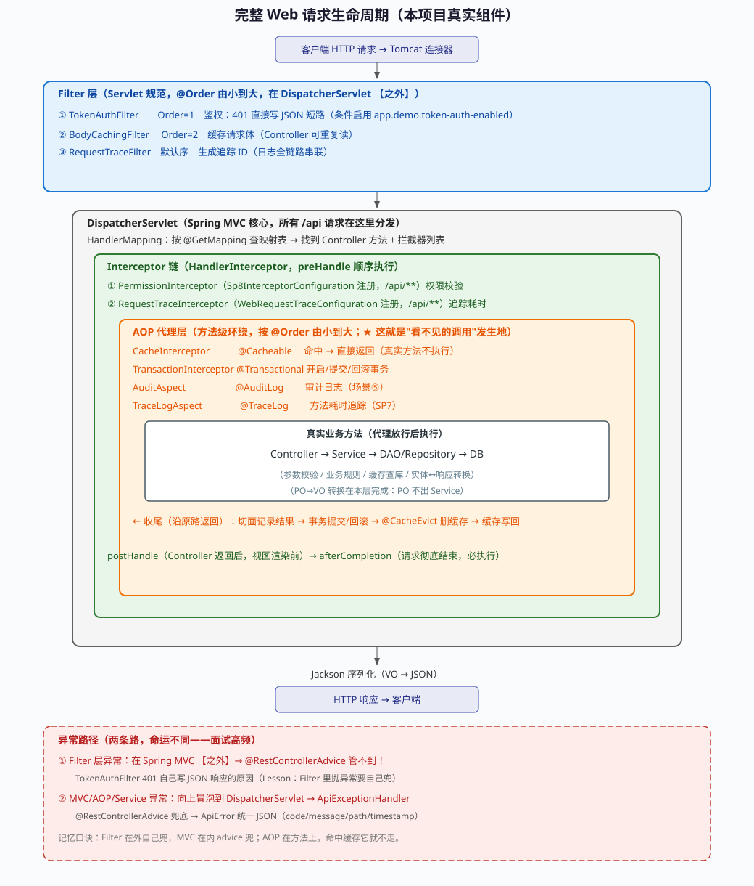
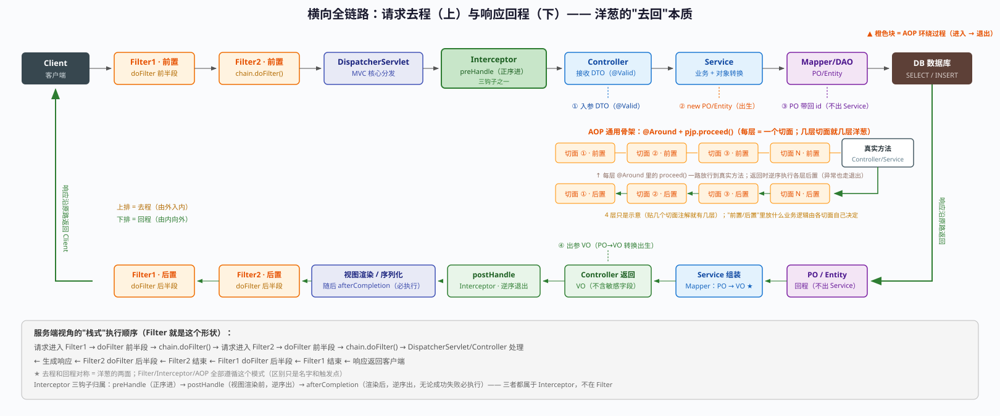
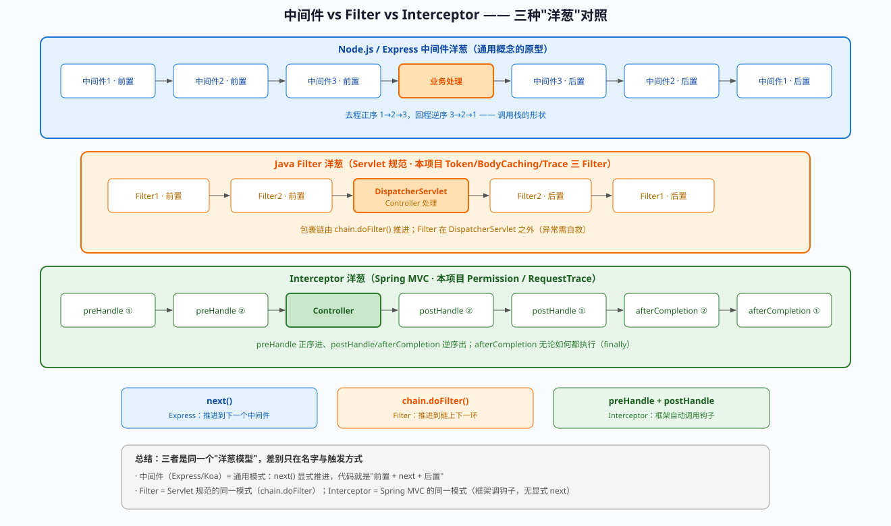

# 专题 · 从 Servlet 到 Spring Boot——一次请求的完整旅程

> **定位**：补 J1–J9 没覆盖的「Web 层」。你天天写 `@GetMapping`，但很少问过——**这个请求是怎么从网卡走到我这个方法的？**
> **用法**：排查 404 / 405 / 跨域 / Header 丢失 / Filter 不生效 / 静态资源被拦时，先回这篇对链路。
> **建立**：2026-10-21（源自课堂追问"Servlet 是什么，Node 有吗，Spring Boot 里是什么表现"）

---

## 0. 一句话定义

> **Servlet 是 Java 官方定义的一个接口。Tomcat 把网络请求解析完后，通过这个接口回调你的代码。**

三个"不是"要先划清：

| 常见误解 | 真相 |
|---|---|
| Servlet 是服务器 | 不是。**Tomcat 才是服务器**，Servlet 只是它要调用的一个接口 |
| Servlet 是框架 | 不是。**Spring MVC 才是框架**，Servlet 是更底层的规范 |
| Servlet 是前端的东西 | 完全在后端，浏览器根本不知道它的存在 |

它既不是网络层，也不是路由层——**它是"被调用的那个点"**。

---

## 1. 没有 Servlet 的世界：手写 Socket 有多痛

浏览器访问一个接口，底层就是一串纯文本通过 TCP 发过来：

```text
GET /api/health HTTP/1.1
Host: localhost:8080
User-Agent: Mozilla/5.0...
Accept: application/json
```

如果 Java 没有 Servlet，你要自己干这些事：

```java
ServerSocket server = new ServerSocket(8080);   // ① 监听端口
Socket socket = server.accept();                // ② 阻塞等连接
InputStream in = socket.getInputStream();       // ③ 读字节
// ④ 手工切字符串判断 GET/POST、扒出路径和参数
// ⑤ 手工拼 "HTTP/1.1 200 OK\r\nContent-Type: ...\r\n\r\n{...}"
OutputStream out = socket.getOutputStream();    // ⑥ 写回字节
socket.close();                                 // ⑦ 关连接
```

痛点不只是"恶心"，还有三件真正难的事：

1. **并发**：1000 个请求 = 1000 个连接，线程怎么管、连接怎么复用？
2. **协议细节**：分块传输（chunked）、Keep-Alive、Content-Length 算错一个字节就乱码
3. **异常路径**：客户端中途断开怎么办？超时怎么办？

这些活跟你的业务（查订单、生成报告）**一点关系都没有**，但每一步写错都会出故障。

---

## 2. 分工：Tomcat 干脏活，Servlet 干业务

Java 官方把这件事切成两半：

```text
浏览器请求（原始 HTTP 文本）
       │
       ▼
┌────────────────────────────────────────────────┐
│  Tomcat（Servlet 容器 / 脏活累活）              │
│  ① 监听 8080 端口，接管底层 TCP Socket          │
│  ② 解析 HTTP 文本，封装成 HttpServletRequest    │
│  ③ 准备好空壳 HttpServletResponse               │
└──────────────────────┬─────────────────────────┘
                       │ 按约定调用 service()
                       ▼
┌────────────────────────────────────────────────┐
│  Servlet（你写的业务代码）                       │
│  不用碰 Socket，直接面向对象：                   │
│    String id = req.getParameter("id");          │
│    resp.getWriter().write("{...}");             │
└────────────────────────────────────────────────┘
```

**这就是"接力棒"模型**：Tomcat 把请求包成一个棒子递给你，你把结果塞进另一个棒子递回去，Tomcat 负责把它变成字节流发走。

---

## 3. ★ 一次请求的七步旅程（本专题的心脏）

从"网卡收到字节"到"你的方法被执行"，一共七步。**Servlet 只占第 ⑤⑥ 步**：

```text
① 网卡收到原始字节
   "GET /api/health HTTP/1.1\r\nHost: localhost:8080\r\n\r\n"

② Tomcat 的 Acceptor 线程 accept 连接 → 丢进线程池

③ 工作线程解析报文，new 出两个对象：
     HttpServletRequest  ← 已经装好 method / path / header / body
     HttpServletResponse ← 空壳，等着你往里写

④ Tomcat 查「URL → Servlet 实例」映射表，找到目标 Servlet

⑤ 调用 servlet.service(req, resp)        ★ 接口唯一入口

⑥ HttpServlet.service() 看 method：
        GET  → doGet(req, resp)
        POST → doPost(req, resp)

⑦ 你的代码 return 后，Tomcat 把 resp 里的
   状态行 + 响应头 + 响应体 序列化成字节，写回 socket
```

记住这张图，后面所有"为什么"都能从它推导出来：

- 为什么 `req.getParameter()` 能直接拿到 `?id=100`？→ 因为第 ③ 步已经解析好了
- 为什么 Servlet 里没有 `main` 方法？→ 因为 ①②⑦ 全在 Tomcat 手里
- 为什么响应 `Content-Length` 从来不用你算？→ 因为第 ⑦ 步统一序列化

---

## 4. 继承链：Servlet → GenericServlet → HttpServlet

新手最容易乱的地方：**`Servlet` 是接口，`HttpServlet` 是抽象类**，你继承的是后者。

```text
Servlet                      接口，只有一个核心方法
  │                            service(ServletRequest, ServletResponse)
  ↑
GenericServlet               抽象类，与协议无关
  │                            管 init() / destroy() / getServletConfig()
  ↑
HttpServlet                  抽象类，HTTP 专用
  │                            service(HttpServletRequest, HttpServletResponse) 的实现：
  │                              GET  → doGet()      ← 空实现，等着你覆写
  │                              POST → doPost()
  │                              其他 → doPut() / doDelete() / ...
  ↑
OrderServlet                 你写的，只覆写需要的那一个 doXxx
```

**关键认知：Tomcat 永远只调 `service()`**，`doGet` 只是 `HttpServlet` 转手给你的钩子。

由此推导出一个常被忽略的行为：

> **只覆写 `doGet()` 的 Servlet，收到 POST 请求会返回 `405 Method Not Allowed`。**

因为 `HttpServlet.doGet()` 的默认实现就是 `resp.sendError(405)`。这是**规范定义的行为**，不是 bug。

想接管所有方法，就覆写 `service()` 而不是 `doGet()`。

---

## 5. ★ 单实例多线程（最容易写错的地方）

这是 Java Web 最反直觉的一点，**几乎所有"诡异串数据"的 bug 都源于此**：

| | 真相 |
|---|---|
| 实例数量 | Tomcat 只 `new` **一个** `OrderServlet` 对象，全程复用 |
| 调用方式 | 100 个并发请求 = 100 个线程，**同时调同一个对象** |
| 成员变量 | **所有请求共享**，绝对不能存"当前用户是谁"这类请求级状态 |

用前端能懂的方式写出来就是这样：

```js
// 你以为的：每个请求一个对象
app.get('/user', (req, res) => {
  const ctx = {}                   // 局部变量，天然隔离
})

// Java Servlet 实际是：全局只有一个对象
const singleton = { currentUser: null }

function onRequest(req, res) {
  singleton.currentUser = req.user  // 100 个并发请求互相覆盖！
}
```

这条规则直接解释了 Spring 里两个高频疑问：

- **为什么 `@Controller` / `@Service` 默认是单例？** 因为 Servlet 本来就是单例，Spring 顺着这个模型走。
- **为什么 Controller 里不能塞成员变量？** 同样原因——那是所有请求共享的槽位。

正确的写法只有三种：

```java
@RestController
public class OrderController {

    // ❌ 绝对不能这样
    // private String currentUserId;

    // ✅ 用方法参数（推荐，天然线程安全）
    @GetMapping("/order")
    public String getOrder(@RequestParam String id) { ... }

    // ✅ 需要跨方法传递时用局部变量
    // ✅ 确实要请求级共享时用 ThreadLocal（用完必须 remove）
}
```

---

## 6. 手写一个 Servlet（Spring Boot 之前的写法）

理解原理最有效的方式，是写一次"老派" Servlet：

```java
package com.aiexplorer.researchagent.api.legacy;

import jakarta.servlet.annotation.WebServlet;
import jakarta.servlet.http.HttpServlet;
import jakarta.servlet.http.HttpServletRequest;
import jakarta.servlet.http.HttpServletResponse;
import java.io.IOException;

// 告诉容器：路径是 /api/legacy/hello 的请求归我管
@WebServlet("/api/legacy/hello")
public class LegacyHelloServlet extends HttpServlet {

    // 只处理 GET；POST 过来会由父类返回 405
    @Override
    protected void doGet(HttpServletRequest req, HttpServletResponse resp) throws IOException {
        // Tomcat 已经把 query string 解析好了，直接取
        String name = req.getParameter("name");

        resp.setContentType("application/json;charset=UTF-8");
        resp.setStatus(HttpServletResponse.SC_OK);
        resp.getWriter().write("{\"legacy\":true,\"name\":\"" + name + "\"}");
    }
}
```

在这个类里，**你一行网络代码都没写**——没有 `main`、没有 `ServerSocket`、没有字符串切分。这些全被 Tomcat 屏蔽了。

### `getParameter()` 的一个陷阱

它只能读到 **URL query string** 和 **`application/x-www-form-urlencoded` 的表单体**。

前端发 JSON（`Content-Type: application/json`）时，`req.getParameter("id")` 返回 **null**——JSON body 在 `req.getInputStream()` 里，得自己读。

这也是为什么 Spring MVC 需要 `@RequestBody` 这个注解。

---

## 7. ★ Spring Boot 里 Servlet 去哪了

**它没消失，只是被藏进了一个叫 `DispatcherServlet` 的类里。**

Spring Boot 启动时会往 Tomcat 注册一个 Servlet（`spring.mvc.servlet.path` 默认 `/`），**所有请求都先落进它**：

```text
GET /api/health
  ↓
内嵌 Tomcat（解析 HTTP、new req/resp）
  ↓
DispatcherServlet        ← 唯一注册的 Servlet，总调度台
  ↓ 查自己的路由表（由 @RequestMapping 构建）
HealthController.health()
  ↓
返回值 → Jackson → JSON → 写进 resp
  ↓
Tomcat 序列化成字节发回
```

`DispatcherServlet` 之于 Servlet，就像 **Express 的 router 之于 `http.createServer` 的回调**——外面还是一层薄薄的协议处理，里面全是路由分发。

### 真实启动日志（本项目实测）

```text
Tomcat initialized with port 8080 (http)
Tomcat started on port 8080 (http) with context path '/'
Started ResearchAgentApplication in 10.513 seconds
Initializing Spring DispatcherServlet 'dispatcherServlet'
Initializing Servlet 'dispatcherServlet'
```

三件事从日志里能直接读出来：

1. **Tomcat 跑在你自己的 Java 进程里**（`TomcatWebServer` 是 Spring Boot 的类）
   → 这是 Spring Boot 相对传统 Java Web 的核心卖点：不用先装 Tomcat、不用打 war 包丢 `webapps/`，`java -jar` 就行
2. **`context path '/'`** 说明应用挂在根路径
3. 最后两行的时间戳比启动完成**晚了 24 秒**
   → **`DispatcherServlet` 是懒加载的**，第一次收到请求才初始化

### 项目里的对应代码

```java
@RestController
@RequestMapping("/api/health")
public class HealthController {

    @GetMapping
    public Map<String, Object> health() {
        return Map.of("status", "ok", "timestamp", Instant.now().toString());
    }
}
```

你写的是"一个方法"，Spring 帮你把它变成了 `DispatcherServlet` 路由表里的一行。

而 `ApiExceptionHandler` 的注释，直接把这条链路写在了源码里：

> 请求处理过程中抛出的异常"冒泡"到 DispatcherServlet 时，会按类型查表派发到这里。

---

## 8. 四个必踩的坑

### 坑 1：`javax.servlet` vs `jakarta.servlet`

| Spring Boot 版本 | 包名 |
|---|---|
| 2.x | `javax.servlet` |
| **3.x（本项目 3.5.13）** | **`jakarta.servlet`** |

2022 年之前的教程全是 `javax`，照抄直接编译不过。原因是 Oracle 把 Java EE 捐给 Eclipse 基金会后，不能再使用 `javax` 商标。

### 坑 2：`@WebServlet` 在 Spring Boot 里默认不生效

纯 Tomcat 里 `@WebServlet` 开箱即用；放进 Spring Boot **必须显式开启扫描**：

```java
@SpringBootApplication
@ServletComponentScan      // 不加这行，@WebServlet / @WebFilter / @WebListener 全部失效
public class ResearchAgentApplication { ... }
```

这是从"看教程"到"自己动手"最容易卡住的一步：**类写对了、注解加了、启动也没报错，但访问就是 404**。

### 坑 3：`/` 和 `/*` 不是一回事

| 映射 | 含义 |
|---|---|
| `/` | **默认 Servlet**：精确匹配优先，它兜底 |
| `/*` | **覆盖一切**：连静态资源、JSP 都拦 |

Spring Boot 的 `DispatcherServlet` 注册在 **`/`**，不是 `/*`。

日常开发无感，但排查「静态资源被拦截」「某个路径莫名 404」时，这个区别会浮出来。

### 坑 4：Filter 与 Interceptor 的位置不同

```text
请求 → Tomcat → 【Filter】 → DispatcherServlet → 【Interceptor】 → Controller
                  ↑                                  ↑
            Servlet 规范层                      Spring MVC 层
              （更早）                            （更晚）
```

| | Filter | Interceptor |
|---|---|---|
| 所属规范 | Servlet | Spring MVC |
| 能拿到什么 | 原始 `HttpServletRequest` | Spring 的 `HandlerMethod`（知道要调哪个方法） |
| 能注入 Spring Bean | 构造注入要注意时机 | 天然可以 |
| 典型用途 | 跨域、编码、请求包装、日志埋点 | 登录校验、权限、业务耗时统计 |

本项目跨域用的是 Spring 层方案（`WebMvcConfigurer`），不是原生 Filter：

```java
@Configuration
public class WebCorsConfiguration implements WebMvcConfigurer {

    @Override
    public void addCorsMappings(CorsRegistry registry) {
        registry.addMapping("/api/**")
                .allowedOrigins("http://localhost:3000", "http://127.0.0.1:3000");
    }
}
```

---

## 9. 现场验证：Servlet 与 Controller 共存

在项目里临时加一个老派 Servlet（第 6 节那段代码），启动类补 `@ServletComponentScan`，然后：

```bash
curl "http://localhost:8080/api/legacy/hello?name=alice"
# {"legacy":true,"name":"alice"}     ← 走原生 Servlet

curl "http://localhost:8080/api/health"
# {"status":"ok", ...}               ← 走 DispatcherServlet
```

两个接口，一个绕过 Spring 直接由 Servlet 处理，一个走 `DispatcherServlet` 转发到 Controller，**在同一个 Tomcat 里并存**。

看到这个现象，"Servlet 是什么"就再也不会混了。

想再看细一点，临时打开 DispatcherServlet 的日志：

```yaml
logging:
  level:
    org.springframework.web.servlet.DispatcherServlet: DEBUG
```

重启后访问任意接口，日志会打出它匹配到的 Controller 方法——第 ⑦ 节的链路就跑在你眼前了。

> 验证完记得删掉临时 Servlet 和 `@ServletComponentScan`，别留在仓库里。

---

## 10. 项目关联地图

| 概念 | 仓库里的位置 | 看什么 |
|---|---|---|
| 内嵌 Tomcat 启动 | 启动日志 `backend/logs/*.log` | `Tomcat initialized with port 8080` |
| DispatcherServlet 懒加载 | 同上 | 首次请求时才出现 `Initializing Servlet 'dispatcherServlet'` |
| 路由注册 | `api/controller/ResearchTaskController.java` | `@RestController` + `@RequestMapping("/api/tasks")` |
| 异常冒泡到 DispatcherServlet | `api/controller/ApiExceptionHandler.java` | 类注释直接写了链路 |
| 跨域（Spring 层而非 Filter） | `infrastructure/config/WebCorsConfiguration.java` | `WebMvcConfigurer.addCorsMappings` |
| 内嵌容器依赖 | `backend/pom.xml` | `spring-boot-starter-web` 自带 Tomcat，无 `tomcat` 显式依赖 |
| 优雅停机（容器生命周期） | `application.yml` | `server.shutdown: graceful` |

---

## 附：一句话总结（背这几句就够）

1. **Tomcat 是服务器，Servlet 是插槽**——Tomcat 负责所有网络脏活，只通过 `service()` 回调你；
2. **一次请求七步走**，Servlet 只占"被调用"和"分发到 doXxx"这两步；
3. **`service()` 是唯一入口，`doGet` 只是钩子**——不覆写 `doPost` 就会 405；
4. **Servlet 单实例多线程**——成员变量是所有请求共享的，这是 Controller 不能有状态的根本原因；
5. **Spring Boot 只是"又插了一层"**——`DispatcherServlet` 是唯一注册的 Servlet，你写的 `@GetMapping` 是它内部的第二层路由；
6. **Spring Boot 3 用 `jakarta.servlet`**，`@WebServlet` 必须配 `@ServletComponentScan`。

## 附录：完整请求生命周期图（2026-11-02，本项目真实组件）



> ↑ 一图看全：Filter（外）→ DispatcherServlet → Interceptor → AOP（缓存/事务/切面）→ 真实方法 → 收尾 → 响应

```text
图中每个组件的项目出处（可点进源码对照）：

Filter 层（Servlet 规范，@Order 由小到大，在 DispatcherServlet 之外）：
  ① TokenAuthFilter      Order=1  鉴权（401 短路，条件启用）
  ② BodyCachingFilter    Order=2  请求体缓存（Controller 可重复读）
  ③ RequestTraceFilter   默认序   追踪 ID

Interceptor 层（DispatcherServlet 内部）：
  ① PermissionInterceptor     Sp8InterceptorConfiguration（/api/**）
  ② RequestTraceInterceptor   WebRequestTraceConfiguration（/api/**）

AOP 代理层（方法级环绕，就是"看不见的调用"发生地）：
  CacheInterceptor        @Cacheable    命中即返回（方法体不执行）
  TransactionInterceptor  @Transactional 事务开启/提交/回滚
  AuditAspect             @AuditLog     审计（场景⑤）
  TraceLogAspect          @TraceLog     耗时追踪（SP7）

异常路径（两条路命运不同）：
  ① Filter 层异常 → @RestControllerAdvice 管不到（在 MVC 之外）
     → TokenAuthFilter 401 自己写 JSON 的原因
  ② MVC/AOP/Service 异常 → ApiExceptionHandler 兜底 → ApiError 统一 JSON
```

**记忆口诀**：

```text
Filter 在外自己兜，MVC 在内 advice 兜；
AOP 在方法上，命中缓存它就不走。
```

**读图指南：为什么画成"洋葱"（嵌套框）**：

```text
嵌套框同时编码三个语义（竖排流水线做不到）：

① 进入方向：外 → 内（Filter 包 Interceptor，Interceptor 包 AOP，AOP 包方法）
② 返回方向：内 → 外（沿原路退出，每层在 exit 位置执行收尾）
③ 作用域：越外层"兜底能力"越弱——这是图旁注红框的核心

三种环绕机制的差异（读图要点）：
┌─────────────┬────────────┬──────────────────────┬──────────────────────┐
│ 机制         │ 进入钩子    │ 离开钩子              │ 异常能否被 advice 接住 │
├─────────────┼────────────┼──────────────────────┼──────────────────────┤
│ Filter       │ doFilter 前 │ doFilter 后(finally) │ ✗ 不能（在 MVC 之外）  │
│ Interceptor  │ preHandle   │ postHandle/afterCompletion │ ✓ 能          │
│ AOP          │ @Around 前  │ proceed 后           │ ✓ 能                  │
└─────────────┴────────────┴──────────────────────┴──────────────────────┘

位置决定兜底能力：
  谁在 DispatcherServlet 外面，谁就只能自救（TokenAuthFilter 401 案例）
```
**术语辨析：这张图不能叫"Spring Boot 生命周期"**（2026-11-02 学员问）：

```text
Spring 语境里"生命周期"有三个，时间尺度差三个数量级：

┌──────────────────┬─────────────────────────────────────┬──────────────┬────────────────────────┐
│ 名词              │ 讲的什么                             │ 时间尺度      │ 本项目对应              │
├──────────────────┼─────────────────────────────────────┼──────────────┼────────────────────────┤
│ Spring Boot 应用生命周期 │ 启动→就绪→关闭（进程一生）       │ 一次部署      │ SpringApplication.run / ApplicationStartedEvent / @PreDestroy │
│ Bean 生命周期      │ 实例化→注入→@PostConstruct→代理→使用→@PreDestroy │ 启动期内 │ BeanLifecycleDemo（SP2） │
│ 请求生命周期(本图) │ Filter→DispatcherServlet→Interceptor→AOP→方法→响应 │ 每次请求毫秒级 │ request-lifecycle-flow.svg │
└──────────────────┴─────────────────────────────────────┴──────────────┴────────────────────────┘

包含关系：应用生命周期（进程级）⊃ Bean 生命周期（启动阶段 N 次）⊃ 请求生命周期（每请求一次）

本图准确叫法：① 一次 HTTP 请求的处理流程 ② 请求生命周期（Request Lifecycle） ③ Web 请求处理链路

容易混淆的佐证：
  图里的代理（Cache/事务/切面）是在【Bean 生命周期】的
  postProcessAfterInitialization 阶段生成的 CGLIB 代理——
  两个生命周期在此交汇，但图只画了"请求"这个尺度。
```
## 附录二：横向全链路图（请求去程 + 响应回程，含对象流转）



> ↑ 上排去程（左→右）、下排回程（右→左）——洋葱的两面；中间标注 DTO/PO/VO 的出生与归属

```text
服务端视角的"栈式"执行顺序（Filter 就是这个形状）：

  请求进入 Filter1
      → doFilter() 前半段
          → chain.doFilter()
              → 请求进入 Filter2
                  → doFilter() 前半段
                      → chain.doFilter()
                          → Servlet / Controller 处理
                          ← 生成响应
                      ← doFilter() 后半段
                  ← Filter2 结束
              → doFilter() 后半段
          ← Filter1 结束
  响应返回客户端
```

**读图要点**：

```text
① 上排（去程）：Client → Filter1前 → Filter2前 → DispatcherServlet → preHandle → Controller → Service → DAO → DB
② 下排（回程）：DB → PO/Entity → Service 组装(Mapper PO→VO) → Controller 返回 VO → postHandle → 渲染/序列化 → Filter2后 → Filter1后 → Client
③ 对象流转：
   · 入参 DTO 在 Controller 出生（@Valid 校验）
   · PO/Entity 在 Service/DAO 出生（永不出 Service，回程里就变 VO 了）
   · VO 在 Mapper 转换时出生，随 JSON 回到前端
```

## 附录三：三种"洋葱"对照（中间件 vs Filter vs Interceptor）



```text
三者是同一个模型，差别只在【名字与触发方式】：

中间件（Express/Koa）：代码 = 前置 + next() + 后置      ← 通用模式的原型
Filter（Servlet 规范）：代码 = 前置 + chain.doFilter() + 后置
Interceptor（Spring MVC）：反过来了——框架调钩子：
    preHandle(正序进) → 业务 → postHandle(逆序出) → afterCompletion(逆序，必执行)

★ 共同点：去程正序、回程逆序（调用栈的形状）
★ Java 选型：跨切面通用逻辑（日志/编码/鉴权）→ Filter；
              需要知道 Controller 信息/Spring Bean → Interceptor
```
### 通俗解释：AOP 图里的"Cache 进入 / 事务 进入"是什么意思（2026-11-02 学员问）

**先破误解**：AOP 不是"四个东西排队"，是**四层包装纸层层包住真实方法**；
拆的时候从最外层开始 → 所以有"进入"和"退出"两排。

**"进入/退出" = `@Around` 方法里 `proceed()` 的前半段/后半段**：

```java
@Around("...")                            // ← Cache 切面
Object around(ProceedingJoinPoint pjp) {

    // ═══ 进入（方法执行前）═══
    Object cached = cache.get(key);
    if (cached != null) {
        return cached;                    // ★ 命中 → 内层全跳过
    }

    Object result = pjp.proceed();        // ═══ 放行：进入下一层 ═══

    // ═══ 退出（方法执行后）═══
    cache.put(key, result);
    return result;
}
```

**四层各自的进入/退出**：

| 层 | 进入时 | 退出时 | 生活类比 |
|---|---|---|---|
| Cache | 查缓存，有就直接给 | 把返回值写进缓存 | 前台查"现成复印件"——有就不去后厂做 |
| 事务 | BEGIN（开草稿单） | 成功 COMMIT / 失败 ROLLBACK | 记账：先草稿、最后确认或撕掉 |
| 审计 | 记谁调的/参数/时间 | 记结果（成功/失败） | 门卫登记进出 |
| 追踪 | 记开始时间戳 t0 | 耗时=now-t0，打日志 | 按秒表 |

**一个请求走一遍（POST /api/tasks）**：

```text
Cache 进入（没缓存）→ 事务 进入(BEGIN) → 审计 进入(记录"u1 调 createTask")
  → 追踪 进入(t0)
     ★ 真实方法：Controller→Service→DAO→INSERT→Response
  → 追踪 退出(12ms) → 审计 退出(记录成功) → 事务 退出(COMMIT) → Cache 退出(写缓存)
```

**第二次同请求（缓存命中）**：

```text
Cache 进入 → 有缓存 → 直接返回
→ 事务/审计/追踪/真实方法全都不执行（现象：没有 SQL、没有事务日志）
```

**中途异常**：

```text
追踪 退出(失败,5ms) → 审计 退出(记录失败) → 事务 退出(ROLLBACK) → Cache 退出(不写缓存)
→ 每层"退出"必执行（finally 语义）——这就是画成上下两排的意义
```

**为什么进入正序/退出逆序**：

```text
包礼物：最里=追踪 → 审计 → 事务 → 最外=Cache
拆礼物：Cache → 事务 → 审计 → 追踪
进入=从外往里，退出=从里往外 → 洋葱的两面
```
### 追问：AOP 图里的"缓存"是谁的？自己写的吗（2026-11-02）

**不是自己写的**——是 Spring 框架的缓存拦截器（与事务同构的环绕切面）。

**你写的只有三样**：

```text
① 注解：@Cacheable(value = RedisConstant.CACHE_REPORT, key = "#taskId")
② 配置：CacheConfiguration（Redis 后端 + Jackson 序列化 + TTL 30 分钟）
③ key 常量：RedisConstant（T5）
→ 查/写缓存的逻辑一行没写
```

**框架执行的**：

```text
@Cacheable 被扫描 → Bean 生成代理 → CacheInterceptor.invoke()
  ① 解析注解：cacheName="report"、SpEL("#taskId") → "123"
  ② CacheManager.getCache("report")（→ 你的 RedisCacheManager）
  ③ cache.get("123") → 实际发 GET report::123
      命中 → 直接返回（真实方法不执行）
      未命中 → proceed() → 真实方法 → cache.put()
              → 实际发 SET report::123 <JSON> EX 1800
```

**三种"缓存"别混**：

| 名字 | 是什么 | 本项目 | 谁写的 |
|---|---|---|---|
| Spring Cache 抽象 | @Cacheable + CacheInterceptor | getReportByTaskId 注解 | Spring 框架 |
| Redis 缓存后端 | CacheManager + 序列化/TTL 配置 | CacheConfiguration | 配置 10 行是你写的 |
| Caffeine 本地缓存 | T6 教学实现（L1/L2 演示） | MultiLevelCache（未接入生产） | 教学示例 |

**一句话**：注解声明"要缓存"，配置决定"缓存放哪、怎么存"，逻辑由框架的
CacheInterceptor 执行——和 @Transactional 完全同一个套路（贴标签，框架干活）。
### 追问二：AOP 的通用骨架 vs 具体场景（2026-11-02 学员纠正，重要）

**学员纠对了**：此前讲的"AOP 四层（Cache/事务/审计/追踪）"是**本项目配了这些注解的组合场景**，
不是 AOP 本身。AOP 的通用骨架只有两个关键词：

```java
@Around("切点表达式")                       // ★ 关键词 1：环绕
Object around(ProceedingJoinPoint pjp) {

    前置逻辑();                             //   进入（内容由具体切面决定）

    Object result = pjp.proceed();          // ★ 关键词 2：放行到下一层/真实方法

    后置逻辑();                             //   退出
    return result;
}
```

```text
@Around   = "我要包住这个方法"（前置+后置都归我管）
proceed() = "放行"（★ 不调用 = 真实方法不执行 = 短路）
—— 骨架固定，前置/后置的"内容"才是各切面的业务
```

**不同切面 = 同一骨架的不同填空**：

| 切面 | 前置 | 必须 proceed？ | 后置 |
|---|---|---|---|
| 日志（TraceLogAspect） | 记参数、t0 | ✅ 必须 | 记结果、耗时 |
| 审计（AuditAspect） | 记操作人 | ✅ 必须 | 记结果落库 |
| 事务（TransactionInterceptor） | BEGIN | ✅ 必须 | COMMIT / ROLLBACK |
| 缓存（CacheInterceptor） | 查缓存 | ⚠️ 命中可不调用（唯一短路者） | 写缓存 |

**"洋葱"不是框架规定，是 proceed() 链的自然产物**：

```text
只配日志 → 1 层；日志+事务 → 2 层；本项目的组合 → 4 层
层间靠 proceed() 串起来：第1层 → 第2层 → ... → 真实方法
→ 有几层切面就有几层洋葱；proceed 是"往下钻"的唯一通道
```

**结论**：打日志的 AOP 不需要缓存——它的前置只是记时间、后置算耗时；
别把"具体业务场景的组合"误当成"AOP 机制本身"。