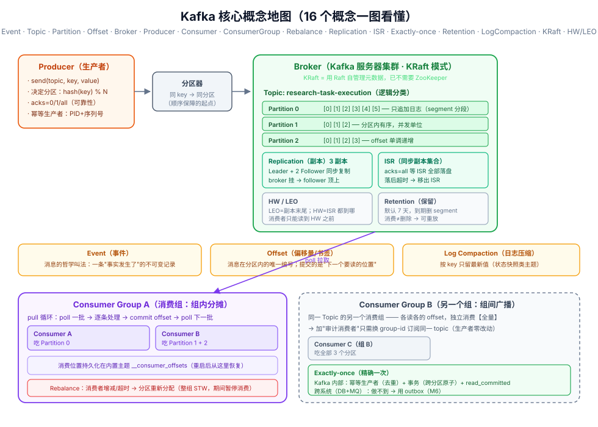

# 附录 · Kafka 核心概念图文总览（16 个概念）

> **用途**：一张图 + 16 个概念的详细讲解，随时查阅。配合 [M3·Kafka基础架构](M3·Kafka基础架构.md) 使用。
> **每个概念格式**：ASCII 图示 → 中文定义 → 详细讲解（类比 / 项目实例 / 常见误区）。



---

## 1. Event（事件）

```text
用户下单 ──→ ┌──────────────────────────────────────┐
             │ event: {                             │
             │   "type": "order.created",           │  ← 一条"事实发生了"的记录
             │   "orderId": 123,                    │
             │   "amount": 99.0,                    │
             │   "timestamp": "2026-11-19T10:00:00" │
             │ }                                    │
             └──────────────────────────────────────┘
```

**定义**：Kafka 里"一条消息"的哲学叫法——**一个已经发生的事实**（不可变、可回放）。

**详细讲解**：

```text
① 为什么叫"事件"而不是"消息"：
   消息听起来像"通知"（可以被丢弃/重发），事件强调"事实已发生"（应该被记录/可回放）
   → 这是 Kafka 的设计哲学：日志 = 事实的流水账
② 不可变：事件写入后不能改（只能追加新事件）→ 这正是"事件溯源"的基础
③ 项目实例：TaskExecutionProducer 发出的 taskId 就是一条"任务需要执行"的事件
④ 误区：把 Event 当成 RPC 请求（期待即时响应）——事件是单向的，响应靠另一个事件
```

## 2. Topic（主题）

```text
         ┌────────────────────────────────────────────┐
Topic A  │ Topic: research-task-execution              │  ← 逻辑分类（业务维度）
         │ Topic: research-task-progress（假设）        │
         │ Topic: audit-log（假设）                     │
         └────────────────────────────────────────────┘
```

**定义**：消息的**逻辑分类/数据流名称**（类似数据库的表名、文件系统的目录）。

**详细讲解**：

```text
① Topic 是"逻辑"概念，物理存储落在 Partition 上（一个 Topic = N 个 Partition）
② 命名建议：业务域.实体.动作（如 task.execution.requested）——便于 topic 数量增长后管理
③ 项目实例：
   TaskExecutionProducer.TOPIC = "research-task-execution"
   生产者/消费者共用常量——避免两处写死字符串漂移（改 topic 名只改一处）
④ Topic 数量控制：不要"每个消费者一个 topic"（元数据/连接开销爆炸）
   → 一个 topic 多个消费组（组间广播）才是 Kafka 的广播姿势
⑤ 误区：Topic 不是队列——它不保证全局顺序（顺序单位是 Partition）
```

## 3. Partition（分区）

```text
Topic: research-task-execution
  ┌─ Partition 0 ─────────────────────────────────┐
  │  [offset0][offset1][offset2][offset3] ──追加──→  │  ← 只追加日志（append-only）
  └───────────────────────────────────────────────┘
  ┌─ Partition 1 ─────────────────────────────────┐
  │  [offset0][offset1][offset2]                  │
  └───────────────────────────────────────────────┘
  ┌─ Partition 2 ─────────────────────────────────┐
  │  [offset0][offset1][offset2][offset3][offset4]│
  └───────────────────────────────────────────────┘
        ↑ 每个分区内：有序、单调递增、可并行消费
```

**定义**：Topic 的**物理分片**——每个分区是一段只追加的日志（磁盘上是多个 segment 文件）。

**详细讲解**：

```text
① 三个作用：
   · 存储：消息真正落在分区（Topic 只是逻辑名）
   · 顺序：分区内消息严格有序（这是 Kafka 唯一的"有序单位"）
   · 并发：分区是消费并行的单位（一个分区只能被同组一个消费者吃）
② 分区数怎么定：
   · 并发上限 = 分区数（3 分区 → 最多 3 个消费者实例并行）
   · 不能太大（元数据/文件句柄开销）也不能太小（扩不了并发）
   · 项目：3 分区（TaskTopicConfiguration.partitions(3)）
③ 消息进哪个分区：hash(key) % 分区数
   · 同 key → 同分区（项目 key=taskId → 同任务有序）
   · 无 key → 轮询（顺序不保证）
④ 误区：分区数可以随便加——加分区会改变 key 落点，历史顺序可能受影响（M4 讲过）
```

## 4. Offset（偏移量）

```text
Partition 1:
  [0] [1] [2] [3] [4] [5] [6] [7]
       ↑       ↑                 ↑
  committed   current         log-end
  (已提交)    (读到这里)       (最新消息的下一位置)

LAG = log-end - committed = 6 - 1 = 5 条积压
```

**定义**：消息在**分区内的唯一递增编号**（从 0 开始）；消费端提交的 offset 是"**下一个要读的位置**"。

**详细讲解**：

```text
① 三个 offset 要分清：
   · log-end offset（LEO）：分区最新消息的"下一条"编号（= 消息总数）
   · committed offset（CURRENT-OFFSET）：消费者已提交的位置（= 下一条要读的）
   · LAG = LEO - committed（积压条数，M3 第四节读法）
② offset 存在哪：内置主题 __consumer_offsets（项目实测存在于主题列表）
   → 消费者重启后从这里恢复（不丢位置）；同组内共享
③ 关键特性：offset 只是"书签"——提交 offset 不会删除消息（≠ RabbitMQ 的 ACK 删除）
   → 所以可以重置 offset 重放（--from-beginning）
④ 误区：offset 是"全局唯一"——不是！每个分区各自递增（partition 0 的 offset 5 和 partition 1 的 offset 5 是两条不同消息）
```

## 5. Broker（代理/服务器）

```text
┌─ Broker 1（Kafka 进程）────────────┐   ┌─ Broker 2 ────────┐
│  Partition0 (Leader)               │   │ Partition0(Replica)│
│  Partition1 (Replica)              │   │ Partition1(Leader) │
│  Controller（KRaft 模式）           │   │                    │
└────────────────────────────────────┘   └────────────────────┘
        ↑ 一个 Kafka 服务进程 = 一个 Broker（通常一台机器一个）
```

**定义**：一个 Kafka **服务进程**（集群里的一个节点）；负责存储分区、处理生产/消费请求、副本同步。

**详细讲解**：

```text
① 集群形态：多个 Broker 组成集群；分区在 Broker 间分布 + 副本
② Leader/Follower：每个分区的 Leader 负责读写，Follower 只做副本同步（M3/M4 讲）
③ Controller：集群里的"管理员"（选 Leader/管分区分配）
   · 旧版：ZooKeeper 当 Controller
   · 新版：KRaft 模式下 Controller 由 Broker 自己选（见第 16 条）
④ 项目实例：docker 的 research-kafka 容器 = 1 个 Broker（单节点，replicas=1）
⑤ 误区：Broker 不是"一个 topic 一个服务"——一个 Broker 承载成百上千个分区的不同角色
```

## 6. Producer（生产者）

```text
App ──send(topic, key="task-1", value="...")──→ ┌──────────────┐
                                                │ 分区器         │
                                                │ hash("task-1") │
                                                │      % 3       │
                                                └──────┬───────┘
                                                       ↓
                                            Partition 1（固定）
```

**定义**：向 Kafka 写入消息的客户端；决定消息进哪个分区、是否等待确认（acks）。

**详细讲解**：

```text
① 核心决策：
   · 分区：key 哈希（同 key 同分区）/ 无 key 轮询 / 自定义分区器
   · 可靠性：acks=0（不管）/ 1（leader 落盘）/ all（ISR 全部）
   · 重试：retries + delivery.timeout
   · 去重：enable.idempotence（PID + 序列号，broker 侧去重）
② 批量优化：linger.ms（攒批等待）+ batch-size + compression-type（吞吐 up、延迟 up）
③ 项目实例：TaskExecutionProducer（send(topic, taskId, taskId) + acks 默认 all）
   轻消息原则：只发 taskId（任务数据以 DB 为准）
④ 误区：send() 返回成功 ≠ 消息已落盘：
   · acks=0/1 时可能丢（M4）
   · 要处理回调（发送失败可重试/落 outbox）
```

## 7. Consumer（消费者）

```text
消费者循环（pull 模型）：
  ┌──────────────────────────────────────────────┐
  │ ① poll(max.poll.records=500)  ← 主动拉一批    │
  │ ② 逐条处理（业务代码）                          │
  │ ③ commit offset（记录读到哪）                   │
  │ ④ 回到 ①（再拉下一批）                          │
  └──────────────────────────────────────────────┘
```

**定义**：从 Kafka 读取消息的客户端；**主动拉取**（不是 broker 推送）、批量处理、提交 offset。

**详细讲解**：

```text
① pull vs push：Kafka 是 pull（消费者自己掌握节奏）→ 好处：积压时不会压垮消费者
② 批量：一次 poll 拉 max.poll.records 条（默认 500）→ 长任务要调成 1（项目已改）
③ 提交时机决定可靠性（ack-mode）：
   · BATCH（默认）：一批处理完才提交 → 长任务危险（项目已改 record）
   · RECORD：每条提交 → 最多重复 1 条
   · MANUAL：代码里 ack 决定（精确控制）
④ 项目实例：TaskExecutionConsumer（@KafkaListener + 状态守卫）
⑤ 误区：消费者不是"一个连接一个消费"——每个消费者线程是一个 poll 循环
```

## 8. Consumer Group（消费组）

```text
Topic（3 分区）
   │
   ├── Partition 0 ──→ Consumer A ┐
   ├── Partition 1 ──→ Consumer B ├─ Group A（组内分摊：一块蛋糕几个人分）
   └── Partition 2 ──→ Consumer B ┘

   ├── Partition 0 ──→ Consumer C ┐
   ├── Partition 1 ──→ Consumer D ├─ Group B（组间广播：各吃一份完整蛋糕）
   └── Partition 2 ──→ Consumer E ┘
```

**定义**：一组消费者的逻辑集合——**组内分摊分区**（协作消费）、**组间各自全量**（广播）。

**详细讲解**：

```text
① 组内分摊：同一 group 的多个实例，各吃不同分区
   → 并发上限 = 分区数（3 分区 → 第 4 个实例闲着）
   → 加实例就能扩并发（到分区数为止）
② 组间广播：不同 group-id 各自独立消费全量（offset 各存各的）
   → 加"审计消费者"= 换一个 group-id 订阅同一 topic（生产者零改动）
③ offset 存储：__consumer_offsets（按 group+topic+partition 存）
④ 项目实例：group-id = research-agent-backend（M3 实测 describe 表里能看到）
⑤ 误区：
   · 同组内"想每个消费者都收到全量"——错，组内是分摊，全量必须换组
   · 改 group-id = 变成新组 → 按 auto-offset-reset 从头/最新开始
```

## 9. Rebalancing（重平衡）

```text
Rebalance 前：              Rebalance 后（Consumer B 挂了）：
  Consumer A → Partition0      Consumer A → Partition0, Partition1, Partition2
  Consumer B → Partition1      （A 独吞全部；期间整组【暂停消费】STW）
  Consumer B → Partition2
```

**定义**：消费组内**分区的重新分配**（消费者增/减、心跳超时、处理超时都会触发）。

**详细讲解**：

```text
① 三个触发条件：
   · 消费者加入/离开（扩缩容、重启）
   · 心跳超时（session.timeout.ms 默认 45s）
   · 处理时间超过 max.poll.interval.ms（默认 5 分钟）★ 长任务必调
② 代价：
   · 整组 STW（暂停消费，秒级~分钟级）
   · 分区易主 → 未提交的消息重投 → 重复执行（靠消费幂等兜）
③ 减少 Rebalance：
   · 调大 max.poll.interval.ms（项目 1h）
   · max-poll-records 调小（项目 1 条一批）
   · 用 CooperativeSticky 分配器（增量式，减少 STW）
   · 避免频繁启停消费者
④ 项目实例：M4 已实测"积压 500 条 × 3 分钟 = 25h >> 1h → 会触发 Rebalance 循环"→ 已改配置规避
⑤ 误区：Rebalance 是"故障"——不是，是正常机制（但频繁重平衡才是病）
```

## 10. Replication（副本）

```text
Partition 0 的三个副本（分布在不同 Broker）：
  ┌─ Broker1: Leader   ── 处理读写 ──┐
  │                                   │ 同步复制
  ├─ Broker2: Follower ── 追 Leader ─┤（fetch 拉取）
  └─ Broker3: Follower ── 追 Leader ─┘

Leader 挂 → ISR 里选一个 Follower 当新 Leader（高可用）
```

**定义**：分区的**多份拷贝**（replication.factor）——一份 Leader（读写）+ N 份 Follower（只同步）。

**详细讲解**：

```text
① 副本数决定高可用：
   · replicas=1：单点（broker 挂 = 分区不可用 + 可能丢数据）——项目开发环境
   · replicas=3：容忍 1 个 broker 挂（生产标配）
② Leader 读写、Follower 只同步：
   · 生产/消费都只找 Leader（Follower 不对外服务）
   · Follower 定期 fetch 拉取（不是 Leader 推送）
③ 副本与性能：acks=all 要等 ISR 全部落盘 → 副本越多延迟越大（可靠 vs 延迟权衡）
④ 项目实例：docker 单节点 ReplicationFactor=1（M3 实测输出）——生产必须 3
⑤ 误区：副本数=3 就一定不丢——还要看 min.insync.replicas 和 unclean 选举配置（M4）
```

## 11. In-Sync Replicas（ISR，同步副本集合）

```text
Partition 0：
  Leader   LEO=100  ┐
  Follower1 LEO=100 ├─ 都在追 Leader → 全部在 ISR
  Follower2 LEO=100 ┘

  若 Follower2 落后太多（LEO=90，超 replica.lag.time.max.ms）：
  → 被移出 ISR → ISR = {Leader, Follower1}
  → 此时 acks=all 只等这 2 个（不等 Follower2）
```

**定义**：与 Leader **保持同步**的副本集合（ISR = in-sync replicas）；`acks=all` 等的是 ISR，不是"所有副本"。

**详细讲解**：

```text
① ISR 是动态的：落后超阈值就踢出（超时 replica.lag.time.max.ms，默认 30s），追上再加回
② 与 acks=all 的关系：
   · acks=all = 等 ISR 中所有副本写入成功
   · 若 ISR 缩到只剩 Leader（min.insync.replicas=1）→ acks=all 退化成 acks=1
   · 所以生产要 min.insync.replicas=2（保证至少 2 副本确认）
③ unclean.leader.election.enable：
   · true：允许落后副本当 Leader（可用性优先，可能丢数据）
   · false：宁不可用不丢数据（生产推荐）
④ 项目实例：单节点 Isr: 1（M3 实测）——开发环境，acks=all 等价 acks=1
⑤ 误区：ISR 就是所有副本——错，落后副本不在 ISR 里（这正是它存在的意义）
```

## 12. HW / LEO（补充：ISR 的配套概念）

```text
Partition 0（3 副本）：
  Leader    LEO=100 ┐
  Follower1 LEO=100 ├─ 三者最小 = 100 → HW = 100
  Follower2 LEO=95  ┘

消费者能读到的范围：offset < 100（HW 之前）
→ 保证"读到的消息一定是已同步的"（不会读到 leader 独有、尚未复制的消息）
```

**定义**：
- **LEO（Log End Offset）**：每个副本日志末尾的下一条位置
- **HW（High Watermark）**：**ISR 全部同步到**的位置（= min(ISR 中所有 LEO)）
- 消费者只能读到 HW 之前的消息

**详细讲解**：

```text
① HW 的作用：保证"消费到的都是已复制到多个副本的"——避免 leader 挂后消息丢（但消费者已经读过了）
② 与 LEO 的关系：HW <= 每个 ISR 副本的 LEO；HW = min(ISR LEO)
③ 项目实例：单副本时 HW = LEO（没有"未复制"的顾虑）——又是开发环境的简化
④ 误区：消费者能读到最新消息——不一定，最新消息可能还没到 HW（复制中）
```

## 13. Exactly-once（精确一次）

```text
生产端去重：Producer(PID=7) ──seq=1──→ Broker（记录 (7,Partition0,seq1)）
            重试再发 ──seq=1──→ Broker 发现重复 → 丢弃（只存一条）

跨分区原子：事务（transactional-id）→ 要么所有分区都写入，要么都不写

消费端：isolation.level=read_committed（只读已提交事务的消息，不读中间态）

★ 但：Kafka 内部的 exactly-once ≠ 跨系统（DB + MQ）的业务 exactly-once
```

**定义**：消息**恰好被处理一次**（不丢也不重）的语义保证。

**详细讲解**：

```text
① Kafka 能做到的三层：
   · 幂等生产者（enable.idempotence）：单分区内生产端不重复
   · 事务（transaction-id-prefix）：跨分区原子写（consume-transform-produce）
   · read_committed：消费端不读未提交事务
② 但业务跨系统做不到：
   · "DB 写入 + 发 Kafka"不是原子操作 → 必须 outbox（M6）
③ 工程现实：多数场景用"至少一次 + 消费幂等"实现"事实上的恰好一次"（项目三层守卫）
④ 项目实例：acks=all + 幂等生产者 + 三层守卫 → 业务效果恰好一次
⑤ 误区：以为开了 Kafka 事务就万事大吉——事务只覆盖 Kafka 内部链路
```

## 14. Retention（保留）

```text
Partition 0 的 segment 文件：
  seg-000000000000.log （最老，即将过期删除）
  seg-000123456789.log （保留中）
  seg-000234567890.log （最新，正在写）

retention.ms=7天 / retention.bytes=1TB → 到期删除整个 segment 文件（不是逐条删）
```

**定义**：消息在 Broker 上**保留多久/多大**（到期删除），**与是否被消费无关**。

**详细讲解**：

```text
① 两种策略：
   · retention.ms（时间，默认 7 天）
   · retention.bytes（大小，磁盘配额）
   超出任一 → 删除最老的 segment 文件
② 为什么"消费不删消息"：offset 只是书签 → 7 天内可 --from-beginning 重放
③ 与"积压"的关系：超过 retention 还没被消费 → 消息被删 → **真的丢**（M6 丢失的终极形态）
④ 项目实例：默认 7 天（未显式配置）；重放实验依赖它
⑤ 误区：retention 是"消费后保留"——错，是"写入后保留"（不看消费）
```

## 15. Log Compaction（日志压缩）

```text
压缩前（key 重复出现）：
  [k1:v1] [k2:v1] [k1:v2] [k3:v1] [k1:v3] [k2:v2]

压缩后（每个 key 只留最新值）：
  [k1:v3] [k2:v2] [k3:v1]

效果：保留"最终状态"而不是"完整历史"（适合状态快照/变更日志）
```

**定义**：一种特殊的清理策略（`cleanup.policy=compact`）——**按 key 只保留最新值**，删除旧版本。

**详细讲解**：

```text
① 与 retention 的区别：
   · retention=delete：按时间删（看"多久前"）→ 保留完整历史（事件流）
   · compaction：按 key 去重（看"同一个 key"）→ 保留最终状态（状态表）
② 典型用途：
   · Kafka Streams 的 changelog（状态备份，重启恢复用最新值）
   · 配置中心/用户画像等"每个 key 一个最终值"的场景
③ 项目实例：没有用 compaction（项目消息是事件流，不是状态快照）
④ 误区：compaction 后 offset 会变——不会！offset 保留空洞（消费者按 offset 读，跳过已删的）
```

## 16. KRaft（Kafka Raft）

```text
旧架构（ZooKeeper 模式）：
  Kafka Broker 集群  ←──元数据──  ZooKeeper 集群
  （两套系统：部署/运维/监控都要双份）

新架构（KRaft 模式，Kafka 3.3+ 生产可用，4.0 默认）：
  Kafka Broker 集群（内含 Controller，用 Raft 协议选主 + 同步元数据）
  （一套系统：deploy/运维成本减半，元数据更新更快）
```

**定义**：Kafka 自研的元数据一致性协议（**K**afka **Raft**）——用 Raft 替代 ZooKeeper 管理集群元数据。

**详细讲解**：

```text
① 为什么要换掉 ZooKeeper：
   · 两套系统运维成本高
   · ZK 成为扩展瓶颈（大规模分区时元数据操作慢）
   · 故障排查链路长
② KRaft 的形态：
   · 节点角色：broker / controller / broker+controller（单节点合体）
   · controller 用 Raft 选举 + 元数据日志（__cluster_metadata 主题）
③ 项目实例（docker-compose 真实配置）：
   KAFKA_PROCESS_ROLES: broker,controller（单节点双角色）
   KAFKA_CONTROLLER_QUORUM_VOTERS: 1@kafka:9093
   → 本项目就是 KRaft 单节点（不需要 ZooKeeper）
④ 误区：KRaft 是"另一个中间件"——不是，它是 Kafka 内置的协议（没有额外进程）
```

---

## 速查表（16 概念 → 一句话 → 项目里在哪）

| # | 概念 | 一句话 | 项目实例 |
|---|---|---|---|
| 1 | Event | 一条"事实发生了"的不可变记录 | taskId 消息 |
| 2 | Topic | 逻辑分类（类似表名） | research-task-execution |
| 3 | Partition | 物理分片（有序 + 并发单位） | 3 分区（NewTopic.partitions(3)） |
| 4 | Offset | 分区内的消息编号（书签） | describe 表 CURRENT/LOG-END |
| 5 | Broker | Kafka 服务进程 | research-kafka 容器（1 个） |
| 6 | Producer | 写入方（定分区 + acks） | TaskExecutionProducer |
| 7 | Consumer | 读取方（pull + 提交） | TaskExecutionConsumer |
| 8 | ConsumerGroup | 组内分摊 / 组间广播 | group-id: research-agent-backend |
| 9 | Rebalancing | 分区重分配（STW） | max.poll.interval.ms=1h 的由来 |
| 10 | Replication | 副本（高可用） | 开发 replicas=1（生产要 3） |
| 11 | ISR | 同步副本集合（acks=all 等它） | 单节点 Isr: 1 |
| 12 | HW/LEO | 已同步位置 / 副本末尾 | 单副本时 HW=LEO |
| 13 | Exactly-once | 精确一次 | 幂等 + 三层守卫（事实恰好一次） |
| 14 | Retention | 消息保留期（与消费无关） | 默认 7 天（可重放窗口） |
| 15 | Log Compaction | 按 key 只留最新值 | 未用（本项目是事件流） |
| 16 | KRaft | 去 ZooKeeper 的元数据协议 | compose 里 broker,controller |

## 概念关系全景（怎么串起来）

```text
Producer 把 Event 按 key 路由到 Topic 的某个 Partition（第 6/1/2/3 条）
  → Partition 在 Broker 上有多个 Replica，Leader 处理读写、Follower 同步（第 5/10 条）
  → ISR 决定 acks=all 等谁；HW 决定消费者能读到哪（第 11/12 条）
  → Consumer 以 ConsumerGroup 为单位 pull 消费、提交 Offset（第 7/8/4 条）
  → 消费者增减触发 Rebalancing（第 9 条）
  → 消息按 Retention 保留可重放；状态类主题用 Log Compaction（第 14/15 条）
  → 可靠保证 = 幂等 + 事务 + read_committed = Exactly-once（第 13 条）
  → 元数据由 KRaft 管理（第 16 条）
```

## 自测（15 题速答）

```text
1  Event 与 Message 的区别？            → 哲学叫法：事实 vs 通知
2  Topic 与 Partition 的关系？          → 逻辑分类 vs 物理分片
3  分区数决定什么？                      → 并发上限 + 顺序单位
4  offset 提交会删消息吗？              → 不会（书签），retention 才删
5  LAG 怎么算？                          → LOG-END - CURRENT
6  Broker 的单点风险？                   → replicas=1 丢数据 + 不可用
7  Producer 怎么决定分区？               → hash(key)%N（或轮询/自定义）
8  Consumer 是推还是拉？                 → pull（自己掌握节奏）
9  组内分摊 vs 组间广播？                → 分区分摊 vs 各自全量
10 Rebalance 什么时候触发？              → 增减/心跳超时/max.poll 超时
11 replicas=3 就高可用吗？               → 还要 ISR/min.insync/unclean 配置
12 ISR 空了会怎样？                      → acks=all 退化；unclean=true 可用但可能丢
13 Kafka 事务能解决 DB+MQ 一致性吗？     → 不能，要 outbox
14 retention 与 compaction 区别？        → 按时间删 vs 按 key 留最新
15 KRaft 替代了什么？                     → ZooKeeper（内置 Raft 管元数据）
```
