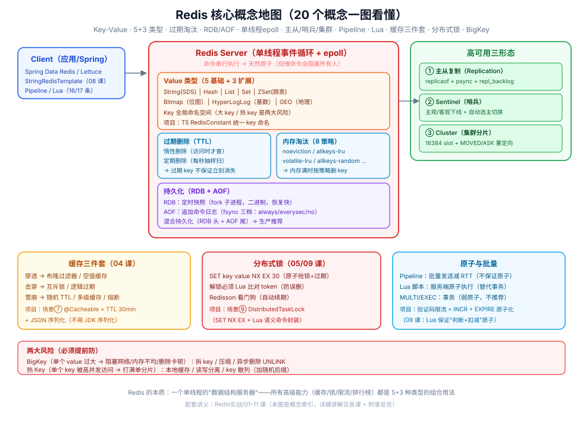

# 附录 · Redis 核心概念图文总览（20 个概念）

> **用途**：一张概念地图 + 20 个概念的详细讲解，随时查阅。配套 01–11 课（本附录是索引性质，细节看各课）。
> **每个概念格式**：ASCII 图示 → 中文定义 → 详细讲解（类比 / 项目实例 / 常见误区）。



---

## 1. Key-Value（键值模型）

```text
Redis 全局命名空间：
  ┌─────────────────────────────────────────────┐
  │ task:42:status        → "COMPLETED"         │
  │ task:42:report        → "..."               │
  │ rate:login:user:7     → 5                   │
  │ lock:task:42          → "token-abc"          │
  └─────────────────────────────────────────────┘
  每个 key 是字符串 → 指向一个 value（5+3 种类型之一）
```

**定义**：Redis 是最简单的键值数据库——**一个巨大的哈希表**，key 是字符串，value 是 5+3 种数据结构之一。

**详细讲解**：

```text
① key 设计原则（T5 课）：
   · 语义化前缀：业务:实体:id:字段（task:42:status）
   · 常量集中：RedisConstant（项目 T5 落地，防拼写漂移）
   · 避免大 key（见第 20 条）和热 key
② value 类型由你选：String（计数）/ Hash（对象）/ List（队列）/ Set（去重）/ ZSet（排行榜）
③ key 数量理论上限 2^32，实际受内存限制
④ 项目实例：T5 RedisConstant 统一定义 key 模板 + 场景⑦ 缓存 key
⑤ 误区：Redis 不是"只有 String"——value 是 5+3 种类型，选错类型会浪费内存/丢功能
```

## 2. String（字符串 / SDS）

```text
SET task:42:status "COMPLETED"
     ┌────────────────────┐
     │ key: task:42:status │──→ value: "COMPLETED"
     └────────────────────┘

内部：SDS（Simple Dynamic String）
  ┌──────┬──────┬─────────────────┐
  │ len  │ free │  buf（字节数组）  │  ← 预分配 + 二进制安全
  └──────┴──────┴─────────────────┘
```

**定义**：最基础的类型——**任意二进制安全的字节串**（可以存 JSON、序列化对象、数字、图片）。

**详细讲解**：

```text
① 为什么不用 C 字符串：C 的 char* 遇 \0 截断、strlen O(n)；SDS 有 len 字段 → O(1) 取长度 + 二进制安全
② 能干什么（用途最广）：
   · 缓存对象（JSON 序列化后存）
   · 计数器（INCR/DECR 原子自增）
   · 分布式锁（SET NX EX）
   · 位图（Bitmap 是 String 的位操作）
③ 项目实例：场景⑦ 报告缓存 = String 存 JSON（Jackson 序列化）；验证码限流 = INCR + EXPIRE
④ 误区：String 存对象要序列化——序列化方式很关键（项目用 JSON，不用 JDK 序列化，见 08 课踩坑）
```

## 3. Hash（哈希表）

```text
HSET task:42 status "COMPLETED" title "AI研究" duration 300

task:42 → ┌────────────────────────────┐
          │ status   → "COMPLETED"      │
          │ title    → "AI研究"          │
          │ duration → 300              │
          └────────────────────────────┘
  小 hash：压缩列表（listpack）← 省内存
  大 hash：哈希表（dict）
```

**定义**：字段-值的集合（类似一行表记录/一个对象）；适合存**对象的多个字段**。

**详细讲解**：

```text
① 相比 String 存 JSON 的优势：
   · 可以单独改/读某个字段（HGET/HINCRBY），不用整存整取
   · 小数据量内存更省（listpack 编码）
② 不适合：字段特别多的大 hash（大 key 风险）；需要过期时间的场景（Hash 只有整体 TTL，不能给字段设 TTL）
③ 项目实例：可用 Hash 存任务的多字段状态（本项目用 JPA 实体 + String 缓存，没上 Hash——合理取舍）
④ 误区：Hash 的字段不能单独过期——"每个字段不同 TTL"要拆成多个 key
```

## 4. List（列表 / quicklist）

```text
LPUSH log:task:42 "开始执行"
RPUSH log:task:42 "执行完成"

log:task:42 → [开始执行] → [执行完成] → ...
                ↑ 左边进        ↑ 右边进
  可当队列（LPUSH + RPOP）或栈（LPUSH + LPOP）或最新列表（LPUSH + LTRIM 100）
```

**定义**：有序的双向列表；底层是 quicklist（链表 + 压缩列表的组合）。

**详细讲解**：

```text
① 三种玩法：
   · 队列：LPUSH（左进）+ RPOP（右出）→ FIFO
   · 栈：LPUSH + LPOP → LIFO
   · 最新 N 条：LPUSH + LTRIM 0 99（只留 100 条）
② 用途：简单消息队列（⚠ 没有 ACK/重试，生产用 MQ）、最新动态、操作日志
③ 项目实例：可用 List 存任务操作日志（本项目用 DB 事件表——更可靠）
④ 误区：List 当 MQ 不保证可靠（消费失败就丢消息，没有重试/死信）——要可靠用 Kafka/RabbitMQ
```

## 5. Set（集合）

```text
SADD task:42:tags "ai" "research" "llm"
SINTER task:42:tags task:43:tags   ← 交集（共同标签）

task:42:tags → {ai, research, llm}   ← 无序、去重
  小集合：整数集合（intset）
  大集合：哈希表
```

**定义**：无序、去重的字符串集合；支持交/并/差集运算。

**详细讲解**：

```text
① 核心能力：去重（SADD 自动去重）+ 集合运算（SINTER/SUNION/SDIFF）
② 典型用途：
   · 标签系统（共同标签 = 交集 → 推荐）
   · 点赞/收藏去重（谁赞过）
   · 抽奖（SRANDMEMBER 随机取）
③ 项目实例：可用 Set 做"任务标签去重"（当前项目没用到）
④ 误区：Set 无序且不能按分数排序——要排序用 ZSet
```

## 6. ZSet（有序集合 / 跳表）

```text
ZADD rank:weekly 100 "task-a" 85 "task-b" 60 "task-c"

rank:weekly（按 score 排序）：
  task-a (100)
  task-b (85)
  task-c (60)

底层：跳表（skiplist）+ 哈希表
  level 3:  ─────────────────→ task-a
  level 2:  ─────→ task-b ───→ task-a
  level 1:  → task-c → task-b → task-a
```

**定义**：带分数的有序集合（按 score 排序）；底层是**跳表**（查询 O(log N)）+ 哈希表（按 member 查 score O(1)）。

**详细讲解**：

```text
① 为什么用跳表不用红黑树：实现简单 + 范围查询高效（ZRANGEBYSCORE 天然适合）+ 并发/内存友好
② 核心用途：
   · 排行榜（ZADD score + ZREVRANGE 前 N）
   · 延时队列（score = 执行时间戳，定时轮询 ZRANGEBYSCORE 到期的）
   · 带权重的去重/分数统计
③ 项目实例：可用 ZSet 做任务优先级队列/排行榜（当前没用到）
④ 误区：ZSet 的 member 唯一、score 可重复——score 相同按 member 字典序
```

## 7. 扩展类型（Bitmap / HyperLogLog / GEO）

```text
① Bitmap（位图，本质是 String 的位操作）：
   SETBIT sign:2026:11 19 1    ← 19 号签到
     bit:  0 0 0 ... [1] ...    ← 每位一天，1 亿用户 = 12.5 MB
   用途：签到统计（BITCOUNT 数签到天数）、在线状态、布隆过滤器

② HyperLogLog（基数估算）：
   PFADD uv:2026-11-19 user1 user2 ...
   PFCOUNT uv:2026-11-19 → 约 12 万（误差 < 1%）
   12KB 内存估算 2^64 个元素 → 用途：UV 统计（不需要精确列表时）

③ GEO（地理位置）：
   GEOADD shops 116.40 39.90 "shop-1"
   GEOSEARCH shops FROMMEMBER shop-1 BYRADIUS 5 km
   用途：附近的人/店（底层是 ZSet + GeoHash）
```

**定义**：三个"专用小工具"类型——Bitmap（位统计）、HyperLogLog（基数估算）、GEO（地理位置）。

**详细讲解**：

```text
① 共同思想：用极小的内存解决特定问题（而不是用通用结构硬算）
② 选择建议：
   · 需要精确内容 → Set/List
   · 只需要数量（UV）→ HyperLogLog（12KB）
   · 只要 true/false 状态 → Bitmap（每人 1 bit）
   · 距离/范围查询 → GEO
③ 项目实例：可用 Bitmap 做"用户连续签到"、GEO 做"附近任务"（当前没用到）
④ 误区：HyperLogLog 有误差（<1%）且不能查元素明细——要明细就用 Set
```

## 8. TTL / 过期删除策略

```text
SET session:abc "..." EX 1800        ← 30 分钟后过期
TTL session:abc → 1795

过期之后怎么删？两种策略配合：
  ① 惰性删除：访问 key 时才发现过期 → 顺手删（不浪费 CPU，但占内存）
  ② 定期删除：每秒 10 次，随机抽 20 个带 TTL 的 key，过期就删
     （抽样删除，不是全量扫描 → 过期 key 可能"活"一会儿）
```

**定义**：key 的生存时间（TTL）；过期删除靠**惰性删除 + 定期删除**两种策略配合（不是定时器）。

**详细讲解**：

```text
① 为什么不用"每个 key 一个定时器"：100 万个 key = 100 万个定时器（内存/CPU 爆炸）
② 实际行为：过期 key 不保证立刻消失（可能占内存到下次抽样/访问）
③ 与内存淘汰的关系：过期删除管"该删了"，淘汰管"内存满了删谁"（下一条）
④ 项目实例：场景⑦ 缓存 TTL 30 分钟（@Cacheable 的 TTL 由 CacheConfiguration 设置）
   兜底作用：@CacheEvict 漏了也能"最多旧 30 分钟"
⑤ 误区：以为 EXPIRE 到期就精确删除——实际是"最多延迟一会儿"（抽样周期内）
```

## 9. 内存淘汰策略（8 种）

```text
内存达到 maxmemory 时，按策略删 key：
  ┌────────────────────────────────────────────────────┐
  │ noeviction      不淘汰 → 写操作直接报错（默认）      │
  │ allkeys-lru     所有 key 里淘汰最久未用的（推荐缓存） │
  │ volatile-lru    只淘汰设置了 TTL 的 key             │
  │ allkeys-lfu     所有 key 里淘汰使用频率最低的         │
  │ volatile-lfu    只淘汰有 TTL 的频率最低              │
  │ allkeys-random  随机淘汰所有 key                    │
  │ volatile-random 随机淘汰有 TTL 的 key               │
  │ volatile-ttl    淘汰 TTL 最短的                      │
  └────────────────────────────────────────────────────┘
```

**定义**：内存达到上限（maxmemory）时的**删除策略**——8 种组合（all/volatile × lru/lfu/random/ttl + noeviction）。

**详细讲解**：

```text
① 缓存场景选 allkeys-lru（大部分团队默认）
② 混合存储（缓存 + 持久数据）选 volatile-lru（只淘汰带 TTL 的缓存，不动持久 key）
③ noeviction 是默认值 → 缓存写满直接报错（很多线上事故的根因）
④ LRU 是"近似 LRU"（抽样比较，不精确）——Redis 的 LRU 是节省内存的近似实现
⑤ 项目实例：缓存为主 → 建议 allkeys-lru（06 课有详细对比）
⑥ 误区：maxmemory 没设 = 不限制（机器内存打满被 OOM killer 杀）
```

## 10. RDB（快照持久化）

```text
BGSAVE：
  Redis 主进程 ──fork()──→ 子进程（写 dump.rdb 快照）──→ 主进程继续服务
                              ↓
                        dump.rdb（二进制压缩格式，恢复快）

触发：save 配置（如 900 秒内 1 次修改）/ BGSAVE / 主从全量同步
```

**定义**：**定时快照**——把某一时刻的全量数据 fork 子进程写成二进制文件（dump.rdb）。

**详细讲解**：

```text
① fork 的代价：内存翻页（copy-on-write）+ 大内存时 fork 卡顿（主进程阻塞几毫秒~几十毫秒）
② 优点：文件紧凑、恢复极快（加载 RDB 直接进内存）
③ 缺点：两次快照之间的数据会丢（比如 900 秒窗口）
④ 项目实例：Redis 容器默认开 RDB（docker redis:7-alpine 默认配置）
⑤ 误区：RDB 不是"实时"——它只是某个时刻的快照（丢最后一段数据）
```

## 11. AOF（命令日志持久化）

```text
AOF 记录每条写命令：
  *2\r\n$3\r\nSET\r\n$8\r\ntask:42\r\n...   ← 文本协议

fsync 策略（决定丢多少数据）：
  always   每条命令都 fsync → 最安全、最慢
  everysec 每秒 fsync → 最多丢 1 秒（推荐默认）
  no       交给操作系统 → 可能丢几十秒

AOF 重写（rewrite）：日志越写越大 → 后台重写成"最小命令集"（BGREWRITEAOF）
```

**定义**：**追加命令日志**——每条写命令追加到文件；重启时重放命令恢复数据。

**详细讲解**：

```text
① 三种 fsync 的取舍：always（不丢，性能差）/ everysec（推荐，丢 1 秒）/ no（快，丢多）
② AOF 重写：日志膨胀（同一个 key 被改 100 次 = 100 条命令 → 重写成 1 条最终状态）
③ 生产推荐：RDB + AOF 混合（Redis 4.0+：AOF 文件前半是 RDB 快照，后半是增量命令）
④ 项目实例：开发环境默认 RDB；生产建议开 AOF everysec
⑤ 误区：AOF 是"每条命令绝对不丢"——everysec 下仍可能丢 1 秒
```

## 12. 单线程 + IO 多路复用（为什么快）

```text
单线程事件循环：
  ┌──────────────────────────────────────────────┐
  │ while(true) {                                │
  │   epoll_wait()  ← 等"哪个 fd 有数据"（不阻塞）  │
  │   handle(fd)    ← 读命令 → 内存操作 → 回包      │
  │ }                                            │
  └──────────────────────────────────────────────┘
  ↑ 一个线程串行处理所有命令（没有锁竞争）

为什么快：
  ① 纯内存操作（纳秒级）
  ② epoll 多路复用（一个线程管几万个连接）
  ③ 单线程无锁无上下文切换
  ④ 命令轻（别放慢命令进去，如 KEYS *）
```

**定义**：Redis 用**单线程 + IO 多路复用（epoll）**处理命令——单条命令纯内存执行，串行无锁。

**详细讲解**：

```text
① 快的真相：不是"单线程快"，而是"内存操作 + 无锁 + 高效 IO 模型"快
② 单线程的代价：一条慢命令（KEYS */大 key DEL）会阻塞所有请求
   → 禁用 KEYS，大 key 用 UNLINK 异步删，慢查询用 SCAN 分批
③ Redis 6.0+ 的"多线程"是 IO 线程（网络读写并行），命令执行仍是单线程
④ 项目实例：场景⑦ 缓存读（O(1) GET）/ 场景⑨ 锁（SET NX EX 单命令）都是轻命令
⑤ 误区：单线程 = 只能跑一个核 → 错，IO 多线程 + 多实例/集群可以压多核
```

## 13. 主从复制（Replication）

```text
Master ──(全量 RDB)→ Replica1
       ──(增量命令流)→ Replica1/Replica2

初次：psync → 全量同步（RDB 传输）
之后：命令传播（master 写命令发给 replica）
断线：psync + repl_backlog（环形缓冲）→ 增量补发（不用全量）
```

**定义**：主从复制——Master 处理写、Replica 同步数据（读扩展 + 高可用基础）。

**详细讲解**：

```text
① 三个用途：读扩展（读写分离）、数据备份、高可用基础（哨兵/集群的前提）
② 全量 vs 增量：首次全量（RDB 传输，网络/磁盘开销大）；断线重连走增量（repl_backlog）
③ 复制延迟：主从异步复制 → 从库可能读到旧数据（一致性权衡）
④ 项目实例：docker 单实例（本地开发）；集群化部署（G1）才是主从/哨兵
⑤ 误区：主从 = 高可用 → 不是！主挂了要人切；自动切换靠哨兵（下一条）
```

## 14. Sentinel（哨兵）

```text
Sentinel 集群（3 个哨兵互相监控）：
  Sentinel1 ─┐
  Sentinel2 ─┼─ 监控 Master + Replica
  Sentinel3 ─┘
        ↓ Master 挂 → 主观下线（单个哨兵认为）
                    → 客观下线（多数哨兵同意）
                    → 选举 Leader 哨兵 → 选新 Master → 客户端切换

客户端通过 Sentinel 拿"当前 Master 地址"（不是写死）
```

**定义**：哨兵——监控节点、自动故障转移（选新 Master）、通知客户端（高可用）。

**详细讲解**：

```text
① 主观/客观下线：单个哨兵怀疑（主观）→ 多数哨兵确认（客观）→ 才触发转移
② 选主规则：优先级 > 复制偏移量（数据最新）> runid（最小）
③ 客户端接入：Spring Boot 配 spring.data.redis.sentinel.nodes（自动发现 Master）
④ 项目实例：本地单实例；k8s/生产才用哨兵集群
⑤ 误区：哨兵 = 分片 → 不是！哨兵只解决高可用（不分片）；分片靠 Cluster（下一条）
```

## 15. Cluster（集群分片）

```text
3 主 3 从（每主一从）：
  Master1(slot 0-5460)    ← 分片 1
  Master2(slot 5461-10922) ← 分片 2
  Master3(slot 10923-16383)← 分片 3
  每主一个 Replica（高可用）

客户端算 key 的 slot：CRC16(key) % 16384
  → 落错节点 → 返回 MOVED 重定向（客户端自动跳）
  → 扩容迁移中 → ASK 临时重定向
```

**定义**：Cluster——**分片集群**（16384 个 slot 分给多个 Master），同时具备高可用（主从）和水平扩展。

**详细讲解**：

```text
① 16384 个 slot 的原因：心跳包大小权衡（2^14 位图 = 2KB，够用又不重）
② MOVED vs ASK：MOVED = 槽永久迁走（更新本地缓存）；ASK = 迁移中临时跳转（不更新缓存）
③ 跨 slot 限制：多 key 操作（MGET/MSET/事务）要求同 slot → 用 hash tag `{user:1}:a` 强制同槽
④ 项目实例：场景⑨ 曾连"集群 Redis NodePort"（k8s）；本地 docker 单实例
⑤ 误区：Cluster 支持所有多 key 命令 → 跨 slot 会报 CROSSSLOT 错误（用 hash tag 解决）
```

## 16. Pipeline（管道）

```text
没有 Pipeline：                     有 Pipeline：
  C→R: SET a 1   (RTT 1ms)            C→R: [SET a 1 + SET b 2 + GET a]  一次发送
  C→R: SET b 2   (RTT 1ms)            R→C: [OK + OK + "1"]              一次返回
  C→R: GET a     (RTT 1ms)            → 1 次 RTT 完成 3 条命令
  → 3 次 RTT（网络往返是瓶颈）
```

**定义**：把多条命令**一次性发送**、一次性收结果——减少网络往返（RTT）。

**详细讲解**：

```text
① 收益：N 条命令从 N 次 RTT → 1 次 RTT（跨机房 RTT 10ms 时收益巨大）
② 注意：Pipeline 不保证原子性（中间可能插别的客户端命令）；命令数量别太大（一次几千条，避免缓冲区爆）
③ 与 Lua 区别：Pipeline 是"减少网络往返"（非原子）；Lua 是"服务端原子执行"
④ 项目实例：批量写缓存/批量检查可用 Pipeline（当前项目单条命令为主）
⑤ 误区：以为 Pipeline 是事务——不是，它只是批量传输
```

## 17. Lua 脚本

```text
校验并扣减库存（原子）：
  if tonumber(redis.call('GET', KEYS[1])) >= tonumber(ARGV[1]) then
      redis.call('DECRBY', KEYS[1], ARGV[1])
      return 1
  end
  return 0

EVAL script 1 stock:42 1   ← 整个脚本在 Redis 内原子执行
```

**定义**：在 Redis 服务端**原子执行**的脚本——"判断 + 修改"打包成一步（不会被打断）。

**详细讲解**：

```text
① 解决的痛点：GET 再 SET 的"检查-更新"不是原子（并发下超卖/误删）
   → Lua 把多步操作变成一个原子命令
② 典型用途：分布式锁解锁（比对 token + DEL 原子）、限流（INCR + 判阈值）、库存扣减
③ 与事务（MULTI/EXEC）区别：事务不做回滚、不能中途判断；Lua 可以写逻辑
④ 项目实例：场景⑨ 解锁用 Lua 脚本（RedisConstant 里的 LOCK_UNLOCK_SCRIPT）
⑤ 误区：Lua 脚本里别放慢操作（阻塞单线程）；脚本要短（避免长时间独占）
```

## 18. 缓存三件套（穿透 / 击穿 / 雪崩）

```text
① 穿透：查询不存在的数据 → 每次都打到 DB
   防护：布隆过滤器（先筛"一定不存在"）/ 空值缓存（短 TTL）

② 击穿：单个热点 key 过期瞬间 → 大量请求同时打 DB
   防护：互斥锁（只放一个请求去查 DB）/ 逻辑过期（不物理删除）

③ 雪崩：大量 key 同时过期 / Redis 挂了 → 请求全打 DB
   防护：TTL 加随机值（错开过期）/ 多级缓存 / 熔断降级
```

**定义**：缓存的三种经典故障——穿透（查不存在）、击穿（热点过期）、雪崩（大面积失效）。

**详细讲解**：

```text
① 三者区别（面试必问）：
   · 穿透是"数据不存在"（恶意/无效查询）
   · 击穿是"数据存在但 key 突然失效"（单个热点）
   · 雪崩是"批量失效"（大量 key 同时过期或 Redis 故障）
② 项目实例：场景⑦ @Cacheable + TTL 30 分钟（有 TTL 兜底，但没做布隆过滤器/互斥锁）
③ 误区：以为加缓存就没事——缓存失效瞬间的流量洪峰才是真正的考验
```

## 19. 分布式锁（SET NX EX + Lua 解锁）

```text
抢锁（原子）：
  SET lock:task:42 "token-abc" NX EX 30
  NX = 不存在才设置（抢锁）  EX 30 = 30 秒过期（防死锁）

解锁（必须 Lua 比对 token，防误删别人的锁）：
  if redis.call('GET', KEYS[1]) == ARGV[1] then
      return redis.call('DEL', KEYS[1])
  end

自动续期：Redisson 看门狗（默认 30 秒续一次）
```

**定义**：用 Redis 实现的跨进程互斥锁——`SET NX EX` 抢锁 + Lua 比对 token 解锁。

**详细讲解**：

```text
① 三个核心要素：原子抢锁（SET NX EX 单命令）、过期兜底（防死锁）、token 校验（防误删）
② 为什么不用 SETNX + EXPIRE 两步：不是原子（中间挂掉 = 死锁）→ 必须 SET NX EX 一条命令
③ 看门狗：业务没跑完锁快过期 → Redisson 自动续期（避免锁提前释放）
④ 项目实例：场景⑨ DistributedTaskLock（SET NX EX + Lua 解锁，防止同一任务并发执行）
⑤ 误区：
   · 以为锁能保证绝对互斥——主从切换时可能丢锁（Redlock 也难完全解决）
   · 解锁不校验 token → 可能删了别人的锁（必须 Lua）
```

## 20. BigKey / 热 Key（两大风险）

```text
① BigKey：单个 value 过大（>10MB 或 元素 >5000）
   危害：网络阻塞（一次传大 value）/ 内存不均 / DEL 卡顿（单线程阻塞）
   治理：拆分（hash 分片）/ 压缩 / UNLINK 异步删

② 热 Key：单个 key 被超高频访问
   危害：打满所在分片（集群下热点集中）/ 单线程被打爆
   治理：本地缓存（前置）/ 读写分离 / key 散列（加随机后缀分散）
```

**定义**：Redis 运维的两大"隐形杀手"——大 key（单个太大）和热 key（单个太热）。

**详细讲解**：

```text
① 检测手段：redis-cli --bigkeys（找大 key）/ --hotkeys（需 LFU）/ 慢查询日志
② 大 key 为什么危险：单线程模型下，一个大 key 的读写会阻塞所有请求
③ 热 key 为什么危险：集群分片下，热度集中在一个分片 → 单分片打满（其他分片闲）
④ 项目实例：场景⑦ 报告缓存可能大（长报告 JSON）→ 建议监控 value 大小
⑤ 误区：以为集群能自动解决热 key——不能，热 key 在一个 slot 上（分片解决不了单 key 热点）
```

---

## 速查表（20 概念 → 一句话 → 项目里在哪）

| # | 概念 | 一句话 | 项目实例 |
|---|---|---|---|
| 1 | Key-Value | 巨大哈希表，key 字符串 → value 五种结构 | RedisConstant（T5） |
| 2 | String | 字节串（SDS），万能类型 | 场景⑦ JSON 缓存 / 计数 |
| 3 | Hash | 字段-值集合（对象） | 可用未用（对象用 JSON String） |
| 4 | List | 双向列表（队列/栈/最新 N） | 可用未用 |
| 5 | Set | 去重 + 交并差 | 可用未用 |
| 6 | ZSet | 有序集合（跳表，排行榜/延时） | 可用未用 |
| 7 | Bitmap/HLL/GEO | 位图/基数估算/地理位置 | 可用未用 |
| 8 | TTL 过期 | 惰性删除 + 定期删除 | 场景⑦ TTL 30min |
| 9 | 内存淘汰 | 8 策略，缓存用 allkeys-lru | 建议 allkeys-lru |
| 10 | RDB | 定时快照（fork 子进程） | docker 默认开 |
| 11 | AOF | 命令日志（fsync 三档） | 生产建议 everysec |
| 12 | 单线程+epoll | 命令串行、无锁、禁慢命令 | 场景⑦/⑨ 都是轻命令 |
| 13 | 主从复制 | 读写分离 + 高可用基础 | 集群化部署（G1） |
| 14 | Sentinel | 监控 + 自动故障转移 | 生产高可用 |
| 15 | Cluster | 16384 slot 分片 + 高可用 | 场景⑨ 集群 Redis 接入 |
| 16 | Pipeline | 批量发送减 RTT（非原子） | 批量场景可用 |
| 17 | Lua | 服务端原子执行（判断+修改） | 场景⑨ 解锁脚本 |
| 18 | 缓存三件套 | 穿透/击穿/雪崩 | 场景⑦ 有 TTL 兜底 |
| 19 | 分布式锁 | SET NX EX + Lua 解锁 | 场景⑨ DistributedTaskLock |
| 20 | BigKey/热Key | 大 key 阻塞 / 热 key 打满分片 | 场景⑦ 报告 value 需监控 |

## 概念关系全景（怎么串起来）

```text
Client（Spring Data Redis）
   ↓ 命令（Pipeline 批量 / Lua 原子）
Redis 单线程引擎（epoll）→ 操作 5+3 种 Value 类型
   ↓ key 有 TTL（惰性+定期删除），内存满（8 种淘汰策略）
   ↓ 数据落盘靠 RDB/AOF（重启恢复）
   ↓ 单机不够 → 主从（读扩展）→ 哨兵（自动故障转移）→ Cluster（分片+高可用）
   ↓ 上层的用法 = 缓存三件套（穿透/击穿/雪崩）、分布式锁（SET NX EX+Lua）、限流/排行榜
   ↓ 全程要防：BigKey（阻塞）和热 Key（热点打满）
```

## 自测（20 题速答）

```text
1  key 设计三原则？              → 语义前缀/常量集中/避免大 key
2  SDS 比 C 字符串好在哪？       → O(1) 长度 + 二进制安全
3  Hash 与 String 存对象的取舍？ → Hash 可单字段读写省内存；String 简单
4  List 能当 MQ 吗？            → 能但不保证可靠（无 ACK/重试）
5  Set 与 ZSet 区别？           → 无序去重 vs 带分数排序
6  ZSet 为什么用跳表？           → 范围查询高效 + 实现简单
7  Bitmap 适合什么？             → 签到/在线状态（1 人 1 bit）
8  HLL 的误差和体积？            → <1%，12KB
9  过期 key 会立刻删吗？          → 不会（惰性+定期抽样）
10 缓存场景选哪个淘汰策略？       → allkeys-lru
11 RDB 会丢数据吗？              → 会（两次快照之间的）
12 AOF everysec 丢多少？         → 最多 1 秒
13 单线程为什么快？               → 内存+无锁+epoll（不是"单线程"本身）
14 主从复制能自动切换吗？         → 不能，要哨兵
15 哨兵能分片吗？                 → 不能，分片靠 Cluster
16 Cluster 多少个 slot？          → 16384
17 Pipeline 是原子吗？            → 不是，只减 RTT
18 Lua 解决什么问题？             → "判断+修改"的原子性
19 SET NX EX 与 SETNX+EXPIRE？   → 前者原子，后者两步可能死锁
20 热 key 怎么治？               → 本地缓存/读写分离/key 散列
```
