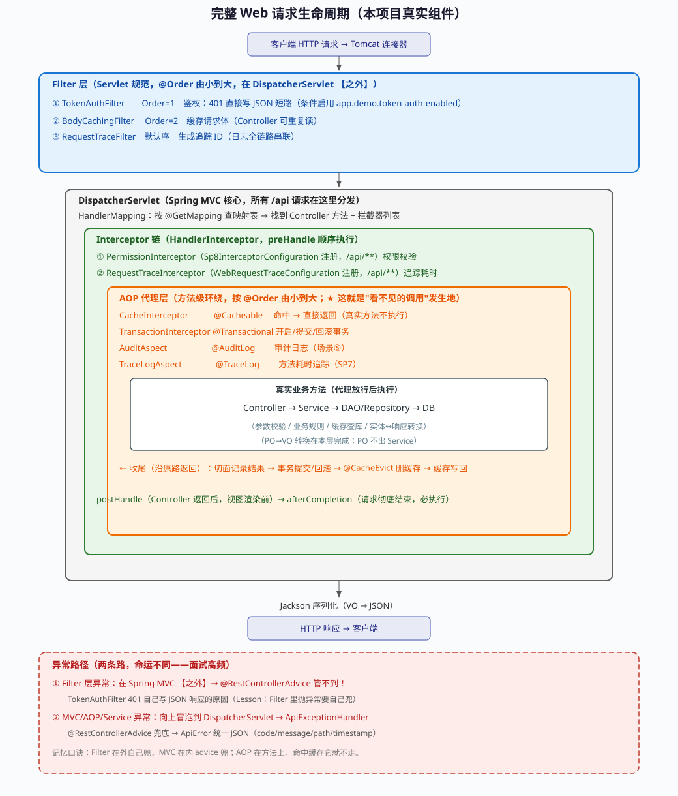
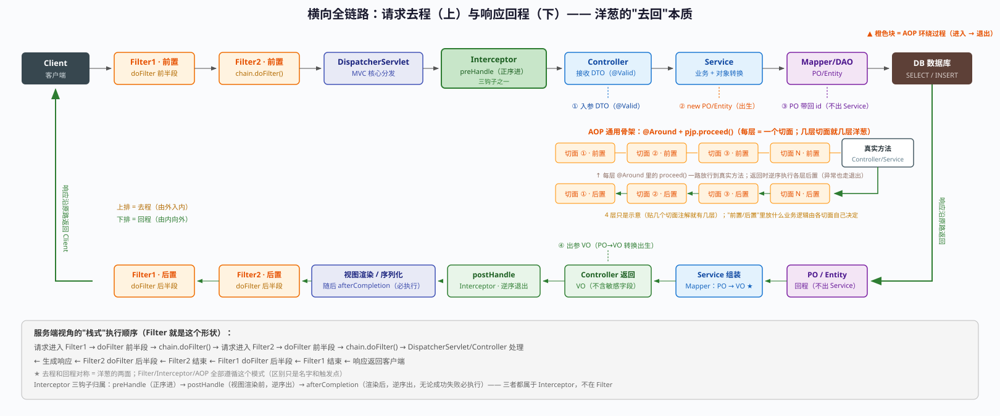
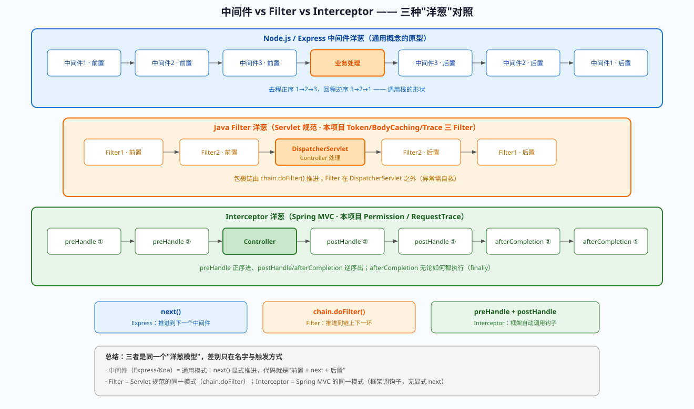

# SP11 · 请求管线手写实战（request-pipeline-lab）

> **定位**：[SP3](SP3·MVC请求处理全流程.md) 讲了"请求怎么流"的理论（对比矩阵）；本课把全链路【每一环亲手写一遍】——Filter / Interceptor / AOP / Controller / Service / PO / Mapper / 异常处理，全部带 `RequestPipline` 前缀、与业务代码隔离。
> **前置**：[SP3](SP3·MVC请求处理全流程.md) / [SP8](SP8·Filter与Interceptor深入.md) / [专题·分层命名体系](../Java基础实战/专题·分层命名体系（PO·DO·DTO·VO·DAO）.md)（对象流转）
> **主题代号**：request-pipeline-lab

---

## 涉及代码文件（点击阅读，按管线顺序）

| 环 | 文件 | 本课中的作用 |
|---|---|---|
| Filter | [`RequestPiplineFilter.java`](../../backend/src/main/java/com/aiexplorer/researchagent/infrastructure/web/requestPipline/RequestPiplineFilter.java) [网页版](https://github.com/dreamChaser-lcc/ai-agent-explorer/blob/main/backend/src/main/java/com/aiexplorer/researchagent/infrastructure/web/requestPipline/RequestPiplineFilter.java) | ★ 注册方式 2 实例（FilterRegistrationBean） |
| Filter 注册 | [`RequestPiplineFilterConfig.java`](../../backend/src/main/java/com/aiexplorer/researchagent/infrastructure/web/requestPipline/RequestPiplineFilterConfig.java) [网页版](https://github.com/dreamChaser-lcc/ai-agent-explorer/blob/main/backend/src/main/java/com/aiexplorer/researchagent/infrastructure/web/requestPipline/RequestPiplineFilterConfig.java) | addUrlPatterns 精确限定练习路径 |
| Interceptor | [`RequestPiplineInterceptor.java`](../../backend/src/main/java/com/aiexplorer/researchagent/infrastructure/web/requestPipline/RequestPiplineInterceptor.java) [网页版](https://github.com/dreamChaser-lcc/ai-agent-explorer/blob/main/backend/src/main/java/com/aiexplorer/researchagent/infrastructure/web/requestPipline/RequestPiplineInterceptor.java) | 三钩子（preHandle/postHandle/afterCompletion） |
| Interceptor 注册 | [`RequestPiplineWebConfig.java`](../../backend/src/main/java/com/aiexplorer/researchagent/infrastructure/web/requestPipline/RequestPiplineWebConfig.java) [网页版](https://github.com/dreamChaser-lcc/ai-agent-explorer/blob/main/backend/src/main/java/com/aiexplorer/researchagent/infrastructure/web/requestPipline/RequestPiplineWebConfig.java) | 只挂 /api/request-pipline/** |
| AOP 注解 | [`RequestPiplineLog.java`](../../backend/src/main/java/com/aiexplorer/researchagent/infrastructure/aop/requestPipline/RequestPiplineLog.java) [网页版](https://github.com/dreamChaser-lcc/ai-agent-explorer/blob/main/backend/src/main/java/com/aiexplorer/researchagent/infrastructure/aop/requestPipline/RequestPiplineLog.java) | 切点锚点（@annotation） |
| AOP 切面 | [`RequestPiplineAspect.java`](../../backend/src/main/java/com/aiexplorer/researchagent/infrastructure/aop/requestPipline/RequestPiplineAspect.java) [网页版](https://github.com/dreamChaser-lcc/ai-agent-explorer/blob/main/backend/src/main/java/com/aiexplorer/researchagent/infrastructure/aop/requestPipline/RequestPiplineAspect.java) | ★ 通用骨架 @Around + proceed |
| Controller | [`RequestPiplineController.java`](../../backend/src/main/java/com/aiexplorer/researchagent/api/controller/requestPipline/RequestPiplineController.java) [网页版](https://github.com/dreamChaser-lcc/ai-agent-explorer/blob/main/backend/src/main/java/com/aiexplorer/researchagent/api/controller/requestPipline/RequestPiplineController.java) | 第 1 环：收 DTO → 分流 → 返回 VO |
| DTO | [`CreateOrUpdateDto.java`](../../backend/src/main/java/com/aiexplorer/researchagent/api/request/requestPipline/CreateOrUpdateDto.java) [网页版](https://github.com/dreamChaser-lcc/ai-agent-explorer/blob/main/backend/src/main/java/com/aiexplorer/researchagent/api/request/requestPipline/CreateOrUpdateDto.java) | 请求体（class + 手写 getter，见踩坑①） |
| 枚举 | [`RequestType.java`](../../backend/src/main/java/com/aiexplorer/researchagent/api/request/requestPipline/RequestType.java) [网页版](https://github.com/dreamChaser-lcc/ai-agent-explorer/blob/main/backend/src/main/java/com/aiexplorer/researchagent/api/request/requestPipline/RequestType.java) | CREATE / UPDATE |
| VO | [`CreateOrUpdateVo.java`](../../backend/src/main/java/com/aiexplorer/researchagent/api/response/requestPipline/CreateOrUpdateVo.java) [网页版](https://github.com/dreamChaser-lcc/ai-agent-explorer/blob/main/backend/src/main/java/com/aiexplorer/researchagent/api/response/requestPipline/CreateOrUpdateVo.java) | 响应体 |
| Service | [`CreateOrUpdateService.java`](../../backend/src/main/java/com/aiexplorer/researchagent/application/service/requestPipline/CreateOrUpdateService.java) [网页版](https://github.com/dreamChaser-lcc/ai-agent-explorer/blob/main/backend/src/main/java/com/aiexplorer/researchagent/application/service/requestPipline/CreateOrUpdateService.java) | ★ PO 出生/死亡的三段式 |
| PO | [`RequestPiplineEntity.java`](../../backend/src/main/java/com/aiexplorer/researchagent/infrastructure/persistence/entity/requestPipline/RequestPiplineEntity.java) [网页版](https://github.com/dreamChaser-lcc/ai-agent-explorer/blob/main/backend/src/main/java/com/aiexplorer/researchagent/infrastructure/persistence/entity/requestPipline/RequestPiplineEntity.java) | 纯 MyBatis POJO（无 JPA 注解，见踩坑⑤） |
| DAO | [`CreateOrUpdateMapper.java`](../../backend/src/main/java/com/aiexplorer/researchagent/infrastructure/persistence/store/mybatis/requestPipline/CreateOrUpdateMapper.java) [网页版](https://github.com/dreamChaser-lcc/ai-agent-explorer/blob/main/backend/src/main/java/com/aiexplorer/researchagent/infrastructure/persistence/store/mybatis/requestPipline/CreateOrUpdateMapper.java) | MyBatis 接口（参数是 PO） |
| XML | [`CreateOrUpdateMapper.xml`](../../backend/src/main/resources/mapper/requestPipline/CreateOrUpdateMapper.xml) [网页版](https://github.com/dreamChaser-lcc/ai-agent-explorer/blob/main/backend/src/main/resources/mapper/requestPipline/CreateOrUpdateMapper.xml) | 显式 SQL（字段↔列映射一眼可见） |
| 异常 | [`RequestPiplineExceptionHandler.java`](../../backend/src/main/java/com/aiexplorer/researchagent/api/controller/requestPipline/RequestPiplineExceptionHandler.java) [网页版](https://github.com/dreamChaser-lcc/ai-agent-explorer/blob/main/backend/src/main/java/com/aiexplorer/researchagent/api/controller/requestPipline/RequestPiplineExceptionHandler.java) | assignableTypes 限定练习 Controller |
| pom | [`pom.xml`](../../backend/pom.xml) [网页版](https://github.com/dreamChaser-lcc/ai-agent-explorer/blob/main/backend/pom.xml) | <parameters>true</parameters>（参数名保留） |

---
## 附录：完整请求生命周期图（2026-11-02，本项目真实组件）



> ↑ 一图看全：Filter（外）→ DispatcherServlet → Interceptor → AOP（缓存/事务/切面）→ 真实方法 → 收尾 → 响应

```text
图中每个组件的项目出处（可点进源码对照）：

Filter 层（Servlet 规范，@Order 由小到大，在 DispatcherServlet 之外）：
  ① TokenAuthFilter      Order=1  鉴权（401 短路，条件启用）
  ② BodyCachingFilter    Order=2  请求体缓存（Controller 可重复读）
  ③ RequestTraceFilter   默认序   追踪 ID

Interceptor 层（DispatcherServlet 内部）：
  ① PermissionInterceptor     Sp8InterceptorConfiguration（/api/**）
  ② RequestTraceInterceptor   WebRequestTraceConfiguration（/api/**）

AOP 代理层（方法级环绕，就是"看不见的调用"发生地）：
  CacheInterceptor        @Cacheable    命中即返回（方法体不执行）
  TransactionInterceptor  @Transactional 事务开启/提交/回滚
  AuditAspect             @AuditLog     审计（场景⑤）
  TraceLogAspect          @TraceLog     耗时追踪（SP7）

异常路径（两条路命运不同）：
  ① Filter 层异常 → @RestControllerAdvice 管不到（在 MVC 之外）
     → TokenAuthFilter 401 自己写 JSON 的原因
  ② MVC/AOP/Service 异常 → ApiExceptionHandler 兜底 → ApiError 统一 JSON
```

**记忆口诀**：

```text
Filter 在外自己兜，MVC 在内 advice 兜；
AOP 在方法上，命中缓存它就不走。
```

**读图指南：为什么画成"洋葱"（嵌套框）**：

```text
嵌套框同时编码三个语义（竖排流水线做不到）：

① 进入方向：外 → 内（Filter 包 Interceptor，Interceptor 包 AOP，AOP 包方法）
② 返回方向：内 → 外（沿原路退出，每层在 exit 位置执行收尾）
③ 作用域：越外层"兜底能力"越弱——这是图旁注红框的核心

三种环绕机制的差异（读图要点）：
┌─────────────┬────────────┬──────────────────────┬──────────────────────┐
│ 机制         │ 进入钩子    │ 离开钩子              │ 异常能否被 advice 接住 │
├─────────────┼────────────┼──────────────────────┼──────────────────────┤
│ Filter       │ doFilter 前 │ doFilter 后(finally) │ ✗ 不能（在 MVC 之外）  │
│ Interceptor  │ preHandle   │ postHandle/afterCompletion │ ✓ 能          │
│ AOP          │ @Around 前  │ proceed 后           │ ✓ 能                  │
└─────────────┴────────────┴──────────────────────┴──────────────────────┘

位置决定兜底能力：
  谁在 DispatcherServlet 外面，谁就只能自救（TokenAuthFilter 401 案例）
```
**术语辨析：这张图不能叫"Spring Boot 生命周期"**（2026-11-02 学员问）：

```text
Spring 语境里"生命周期"有三个，时间尺度差三个数量级：

┌──────────────────┬─────────────────────────────────────┬──────────────┬────────────────────────┐
│ 名词              │ 讲的什么                             │ 时间尺度      │ 本项目对应              │
├──────────────────┼─────────────────────────────────────┼──────────────┼────────────────────────┤
│ Spring Boot 应用生命周期 │ 启动→就绪→关闭（进程一生）       │ 一次部署      │ SpringApplication.run / ApplicationStartedEvent / @PreDestroy │
│ Bean 生命周期      │ 实例化→注入→@PostConstruct→代理→使用→@PreDestroy │ 启动期内 │ BeanLifecycleDemo（SP2） │
│ 请求生命周期(本图) │ Filter→DispatcherServlet→Interceptor→AOP→方法→响应 │ 每次请求毫秒级 │ request-lifecycle-flow.svg │
└──────────────────┴─────────────────────────────────────┴──────────────┴────────────────────────┘

包含关系：应用生命周期（进程级）⊃ Bean 生命周期（启动阶段 N 次）⊃ 请求生命周期（每请求一次）

本图准确叫法：① 一次 HTTP 请求的处理流程 ② 请求生命周期（Request Lifecycle） ③ Web 请求处理链路

容易混淆的佐证：
  图里的代理（Cache/事务/切面）是在【Bean 生命周期】的
  postProcessAfterInitialization 阶段生成的 CGLIB 代理——
  两个生命周期在此交汇，但图只画了"请求"这个尺度。
```
## 附录二：横向全链路图（请求去程 + 响应回程，含对象流转）



> ↑ 上排去程（左→右）、下排回程（右→左）——洋葱的两面；中间标注 DTO/PO/VO 的出生与归属

```text
服务端视角的"栈式"执行顺序（Filter 就是这个形状）：

  请求进入 Filter1
      → doFilter() 前半段
          → chain.doFilter()
              → 请求进入 Filter2
                  → doFilter() 前半段
                      → chain.doFilter()
                          → Servlet / Controller 处理
                          ← 生成响应
                      ← doFilter() 后半段
                  ← Filter2 结束
              → doFilter() 后半段
          ← Filter1 结束
  响应返回客户端
```

**读图要点**：

```text
① 上排（去程）：Client → Filter1前 → Filter2前 → DispatcherServlet → preHandle → Controller → Service → DAO → DB
② 下排（回程）：DB → PO/Entity → Service 组装(Mapper PO→VO) → Controller 返回 VO → postHandle → 渲染/序列化 → Filter2后 → Filter1后 → Client
③ 对象流转：
   · 入参 DTO 在 Controller 出生（@Valid 校验）
   · PO/Entity 在 Service/DAO 出生（永不出 Service，回程里就变 VO 了）
   · VO 在 Mapper 转换时出生，随 JSON 回到前端
```

# 逐环节代码详解（按请求进入顺序：外 → 内 → 出）

> 读法：每一环 = 「完整代码」+「它在这条管线里的位置」+「关键点为什么这么写」+「这一环的日志标记」。
> 全部代码都在 `backend/src/main/java/com/aiexplorer/researchagent/**/requestPipline/` 下，可直接对照源码。

## 环节 1：Filter —— 管线的最外层（进入 Spring 之前）

### 完整代码（`infrastructure/web/requestPipline/RequestPiplineFilter.java`）

```java
package com.aiexplorer.researchagent.infrastructure.web.requestPipline;

import jakarta.servlet.Filter;
import jakarta.servlet.FilterChain;
import jakarta.servlet.ServletException;
import jakarta.servlet.ServletRequest;
import jakarta.servlet.ServletResponse;
import java.io.IOException;

/**
 * 请求管线练习 · 第 2 环：Filter（Servlet 规范，在 DispatcherServlet【之外】）。
 *
 * <p>★ 本类是「注册方式 2」的代码实例：FilterRegistrationBean 手动注册
 * （见 RequestPiplineFilterConfig）。对比项目里另外三个 Filter：</p>
 *
 * <table border="1">
 *   <caption>两种注册方式对照</caption>
 *   <tr><th></th><th>方式 1：@Component + @Order</th><th>方式 2：FilterRegistrationBean（本类）</th></tr>
 *   <tr><td>注册范围</td><td>全部 /*（不可配）</td><td>可精确 URL（本类：/api/request-pipline/*）</td></tr>
 *   <tr><td>顺序</td><td>@Order</td><td>setOrder</td></tr>
 *   <tr><td>判断路径</td><td>需在 doFilter 里判断 URI</td><td>容器按 URL 模式匹配，无需判断</td></tr>
 *   <tr><td>项目实例</td><td>TokenAuthFilter / BodyCachingFilter / RequestTraceFilter</td><td>本类</td></tr>
 * </table>
 *
 * <p><b>⚠ 冲突坑</b>：本类【故意】不加 @Component——若同时被组件扫描和
 * FilterRegistrationBean 注册，会被注册两次、每个请求执行两遍。</p>
 *
 * <p>位置提醒：doFilter 前后把整个 Spring MVC 包在中间——所以 Filter 日志一定
 * 【最先】和【最后】出现。</p>
 */
public class RequestPiplineFilter implements Filter {

    @Override
    public void doFilter(ServletRequest request, ServletResponse response, FilterChain chain)
            throws IOException, ServletException {
        long start = System.currentTimeMillis();
        System.out.println("[Filter]   >>> 进入 doFilter（DispatcherServlet 之前）");
        try {
            chain.doFilter(request, response);   // 放行：后面才会走到 DispatcherServlet
        } finally {
            System.out.println("[Filter]   <<< 退出 doFilter（耗时 "
                    + (System.currentTimeMillis() - start) + "ms）");
        }
    }
}
```

### 逐点讲解

```text
① implements Filter（jakarta.servlet）——Servlet 规范接口，只有 doFilter 一个方法
② 没有任何 Spring 注解——因为注册交给"方式 2"（见下一个文件）；类上是普通类
③ chain.doFilter(request, response) —— ★ 管线的"接力棒"：
     不调用 = 请求到此为止（401 场景就是这么短路）
     调用了 = 交给下一个 Filter → 最终 DispatcherServlet
④ try/finally 包住 chain.doFilter —— 退出日志【无论成功失败】都会打
   （这就是"洋葱"：进入一行、放行、退出一行）
⑤ 耗时统计：start 在进入时取、finally 里算 —— Filter 是唯一能统计
   "整个 Spring MVC 部分总耗时"的地方（它包着全部）
```

### 这一环的日志标记

```text
[Filter]   >>> 进入 doFilter（DispatcherServlet 之前）    ← 一定是第一行
[Filter]   <<< 退出 doFilter（耗时 Xms）                  ← 一定是最后一行
```
## 环节 2：Filter 的注册（方式 2：FilterRegistrationBean）

### 完整代码（`infrastructure/web/requestPipline/RequestPiplineFilterConfig.java`）

```java
package com.aiexplorer.researchagent.infrastructure.web.requestPipline;

import org.springframework.boot.web.servlet.FilterRegistrationBean;
import org.springframework.context.annotation.Bean;
import org.springframework.context.annotation.Configuration;

/**
 * 请求管线练习 · ★ 注册方式 2 的代码实例：FilterRegistrationBean 手动注册。
 *
 * <p>与方式 1（@Component + @Order，见 TokenAuthFilter 等）的区别：</p>
 * <ul>
 *   <li>能精确指定 URL 模式：{@code addUrlPatterns("/api/request-pipline/*")}
 *       —— Filter 里不用再判断 URI；</li>
 *   <li>能命名（setName）：日志/排查时能对上号；</li>
 *   <li>能配初始化参数（setInitParameters）；</li>
 *   <li>可条件化（把 @Bean 包在 @ConditionalOnProperty 里即可开关）。</li>
 * </ul>
 *
 * <p><b>⚠ 坑</b>：配套的 RequestPiplineFilter 类上【不能】加 @Component，
 * 否则同一 Filter 会被注册两次、每个请求执行两遍。</p>
 */
@Configuration
public class RequestPiplineFilterConfig {

    @Bean
    public FilterRegistrationBean<RequestPiplineFilter> requestPiplineFilter() {
        FilterRegistrationBean<RequestPiplineFilter> bean = new FilterRegistrationBean<>();
        bean.setFilter(new RequestPiplineFilter());
        bean.addUrlPatterns("/api/request-pipline/*");   // 精确 URL：只拦练习端点
        bean.setOrder(3);                                // 排在 TokenAuth(1)/BodyCaching(2) 之后
        bean.setName("requestPiplineFilter");            // 命名：便于日志/排查
        return bean;
    }
}
```

### 逐点讲解

```text
① new RequestPiplineFilter() —— 手动 new：因为类上没有 @Component（避免双注册）
② addUrlPatterns("/api/request-pipline/*") —— 只有这个前缀的请求才会进 doFilter
   （对比方式 1：全路径都进，代码里判断 URI）
③ setOrder(3) —— 全局 Filter 链顺序：TokenAuth(1) → BodyCaching(2) → 本 Filter(3)
④ setName —— 出问题时按名字查注册信息（/actuator 或启动日志）
```

## 环节 3：Interceptor —— DispatcherServlet 内部（AOP 之外）

### 完整代码（`infrastructure/web/requestPipline/RequestPiplineInterceptor.java`）

```java
package com.aiexplorer.researchagent.infrastructure.web.requestPipline;

import jakarta.servlet.http.HttpServletRequest;
import jakarta.servlet.http.HttpServletResponse;
import org.springframework.web.servlet.HandlerInterceptor;
import org.springframework.web.servlet.ModelAndView;

/**
 * 请求管线练习 · 第 3 环：Interceptor（DispatcherServlet 内部，AOP 之外）。
 *
 * <p>三个钩子的执行顺序（本练习要亲眼验证的）：
 * <pre>
 *   preHandle（正序进）
 *     → AOP → Controller → Service
 *   postHandle（Controller 返回后，视图渲染前；逆序出）
 *   afterCompletion（请求彻底结束；逆序出，无论成功失败必执行）
 * </pre>
 */
public class RequestPiplineInterceptor implements HandlerInterceptor {

    @Override
    public boolean preHandle(HttpServletRequest request, HttpServletResponse response, Object handler) {
        System.out.println("[Interceptor] >>> preHandle（进入 Controller 之前）");
        return true;   // true = 放行；false = 中断（后续 Controller 不执行）
    }

    @Override
    public void postHandle(HttpServletRequest request, HttpServletResponse response,
            Object handler, ModelAndView modelAndView) {
        System.out.println("[Interceptor] <<< postHandle（Controller 已返回，视图渲染之前）");
    }

    @Override
    public void afterCompletion(HttpServletRequest request, HttpServletResponse response,
            Object handler, Exception ex) {
        System.out.println("[Interceptor] <<< afterCompletion（请求结束，必执行；异常="
                + (ex == null ? "无" : ex.getClass().getSimpleName()) + "）");
    }
}
```

### 逐点讲解

```text
① 三个钩子 = Interceptor 的全部（没有 @Around 那种"一个方法包两半"）
② preHandle 返回 boolean：
   true  = 放行（继续 HandlerAdapter → AOP → Controller）
   false = 中断（后面全不执行；常用于登录拦截——本项目 PermissionInterceptor 就是这个模式）
③ postHandle：Controller 返回【之后】、视图渲染【之前】——
   返回值已经被填好，可以在这里改 ModelAndView（前后端分离项目少用）
④ afterCompletion：必执行（相当于 finally）——
   ex 参数 = 异常对象（无异常为 null），可以在这里记"这次请求是否失败"
⑤ 为什么 afterCompletion 比 postHandle 更适合收尾？
   postHandle 在 Controller 抛异常时【不会执行】；afterCompletion 一定会
```

### 注册（`RequestPiplineWebConfig.java`）

```java
@Configuration
public class RequestPiplineWebConfig implements WebMvcConfigurer {

    @Override
    public void addInterceptors(InterceptorRegistry registry) {
        registry.addInterceptor(new RequestPiplineInterceptor())
                .addPathPatterns("/api/request-pipline/**");   // 只挂练习路径
    }
}
```
## 环节 4：AOP —— 方法级环绕（@Around + proceed）

### 自定义注解（`infrastructure/aop/requestPipline/RequestPiplineLog.java`）

```java
package com.aiexplorer.researchagent.infrastructure.aop.requestPipline;

import java.lang.annotation.Documented;
import java.lang.annotation.ElementType;
import java.lang.annotation.Retention;
import java.lang.annotation.RetentionPolicy;
import java.lang.annotation.Target;

/**
 * 请求管线练习 · 第 4 环的标记注解：贴了它的方法会被 RequestPiplineAspect 环绕。
 *
 * <p>为什么自定义注解：@Around("@annotation(xxx)") 的切点需要"锚点"——
 * 只拦截贴了这个注解的方法，而不是全部方法。</p>
 */
@Target(ElementType.METHOD)
@Retention(RetentionPolicy.RUNTIME)
@Documented
public @interface RequestPiplineLog {

    /** 说明文字（可选，练习里用来标注"这一环在干什么"）。 */
    String value() default "";
}
```

### 逐点讲解

```text
① @Target(METHOD)——只能贴在方法上
② @Retention(RUNTIME)——★ 运行时保留：切面要用反射读到它
   （和 @Controller 一样是运行时注解；区别于 Lombok 的编译期）
③ 为什么自定义注解：@Around("@annotation(xxx)") 的切点需要"锚点"——
   只拦贴了这个注解的方法，而不是全部方法
```

### 切面（`infrastructure/aop/requestPipline/RequestPiplineAspect.java`）

```java
package com.aiexplorer.researchagent.infrastructure.aop.requestPipline;

import org.aspectj.lang.ProceedingJoinPoint;
import org.aspectj.lang.annotation.Around;
import org.aspectj.lang.annotation.Aspect;
import org.springframework.stereotype.Component;

/**
 * 请求管线练习 · 第 4 环：AOP 切面（通用骨架 @Around + proceed）。
 *
 * <p>骨架只有两件事：proceed() 之前放"前置"，之后放"后置"。
 * 本练习的前置/后置只是打日志——这就是"填进骨架里的内容"。</p>
 */
@Aspect
@Component
public class RequestPiplineAspect {

    @Around("@annotation(requestPiplineLog)")
    public Object around(ProceedingJoinPoint joinPoint, RequestPiplineLog requestPiplineLog) throws Throwable {
        long start = System.currentTimeMillis();
        System.out.println("[AOP]      >>> 进入切面（proceed 之前）");

        try {
            Object result = joinPoint.proceed();   // 放行：进到 Controller 方法
            System.out.println("[AOP]      <<< 退出切面（proceed 之后，耗时 "
                    + (System.currentTimeMillis() - start) + "ms）");
            return result;
        } catch (Throwable e) {
            System.out.println("[AOP]      <<< 异常退出（" + e.getClass().getSimpleName() + "），继续上抛");
            throw e;
        }
    }
}
```

### 逐点讲解（这就是 AOP 的通用骨架）

```text
① @Around("@annotation(requestPiplineLog)") —— 切点：只拦贴了 @RequestPiplineLog 的方法
   参数名 requestPiplineLog = 注解实例（能读 value()）
② joinPoint.proceed() —— ★ 唯一的关键词：
   之前写的 = "进入"（proceed 前半段）
   之后写的 = "退出"（proceed 后半段）
   不调用   = 方法不执行（缓存的"命中短路"就是这么做的）
③ catch 里 throw e —— 切面只记日志不吞异常（否则上层 advice 兜不住）
④ try/finally 语义与 Filter 的 doFilter 完全同构——洋葱的每一层都长这样
```
## 环节 5：Controller —— 第 1 环"业务代码"（AOP 里包着的那个方法）

### 完整代码（`api/controller/requestPipline/RequestPiplineController.java`）

```java
package com.aiexplorer.researchagent.api.controller.requestPipline;

import com.aiexplorer.researchagent.api.request.requestPipline.CreateOrUpdateDto;
import com.aiexplorer.researchagent.api.request.requestPipline.RequestType;
import com.aiexplorer.researchagent.api.response.requestPipline.CreateOrUpdateVo;
import com.aiexplorer.researchagent.application.service.requestPipline.CreateOrUpdateService;
import com.aiexplorer.researchagent.infrastructure.aop.requestPipline.RequestPiplineLog;
import io.swagger.v3.oas.annotations.Operation;
import io.swagger.v3.oas.annotations.tags.Tag;
import jakarta.validation.Valid;
import org.springframework.web.bind.annotation.PostMapping;
import org.springframework.web.bind.annotation.RequestBody;
import org.springframework.web.bind.annotation.RequestMapping;
import org.springframework.web.bind.annotation.RestController;

/**
 * 请求管线练习 · 第 1 环：Controller。
 *
 * <p>这一环只做三件事：接参数（DTO）→ 调 Service → 返回 VO。
 * 后续环（Filter/Interceptor/AOP/异常）都围绕它"加包装"。</p>
 */
@RestController
@RequestMapping("/api/request-pipline")
@Tag(name = "请求 pipeline（从 0 手写）", description = "Controller → Service → VO 的最小闭环")
public class RequestPiplineController {

    private final CreateOrUpdateService createOrUpdateService;

    public RequestPiplineController(CreateOrUpdateService createOrUpdateService) {
        this.createOrUpdateService = createOrUpdateService;
    }

    @RequestPiplineLog("第 1 环：Controller")
    @Operation(summary = "创建或更新", description = "请求进入管线的第一环")
    @PostMapping("/create")
    public CreateOrUpdateVo create(@Valid @RequestBody CreateOrUpdateDto dto) {
        System.out.println("[Controller] 收到请求 requestId=" + dto.getRequestId()
                + " type=" + dto.getRequestType());
        // 按请求类型分流（CREATE / UPDATE 走不同 Service 方法）
        if (dto.getRequestType() == RequestType.UPDATE) {
            return createOrUpdateService.update(dto);
        }
        return createOrUpdateService.create(dto);
    }
}
```

### 逐点讲解

```text
① @RestController = @Controller + @ResponseBody：
   方法返回值直接序列化成 JSON（不经视图解析）
② @Valid + @RequestBody：
   @RequestBody = 从请求体 JSON 反序列化成 DTO（对比 @RequestParam 表单/query）
   @Valid       = 触发 DTO 上的 @NotBlank/@NotNull 校验（失败 → MethodArgumentNotValidException）
③ 构造器注入 Service（final 字段 + 构造器 = 不可变 + 测试友好）
④ @RequestPiplineLog 贴在这个方法上 → AOP 的 proceed() 会"钻进"它
   ★ 它本身不知道自己被环绕——这就是 AOP 的解耦
⑤ if 分流（不用 switch）—— 绕开 IDE 对 enum switch 的索引误报（踩坑②）
```

## 环节 6：DTO 与枚举 —— 请求体怎么进来的

### DTO 完整代码（`api/request/requestPipline/CreateOrUpdateDto.java`）

```java
package com.aiexplorer.researchagent.api.request.requestPipline;

import io.swagger.v3.oas.annotations.media.Schema;
import jakarta.validation.constraints.NotBlank;
import jakarta.validation.constraints.NotNull;

/**
 * 创建或更新请求 DTO（请求体）。
 *
 * <p><b>为什么是普通 class + 手写 getter/setter</b>：功能上 record 最简洁，
 * 但本机 IDE 的索引对 record 隐式访问器、以及 Lombok 生成的 getter 识别不稳定，
 * 反复误报 "method undefined"。手写后 IDE 与编译器的认知完全一致，不再误报。</p>
 *
 * <p>IDE 恢复正常后可换回（任选其一，功能等价）：
 * <ul>
 *   <li>record 版：{@code public record CreateOrUpdateDto(String requestId, RequestType requestType, String desc) {}}</li>
 *   <li>Lombok 版：class 上加 {@code @Getter @Setter @NoArgsConstructor}</li>
 * </ul></p>
 */
@Schema(name = "CreateOrUpdateDto", description = "创建或更新请求")
public class CreateOrUpdateDto {

    @Schema(description = "请求id", example = "1234567890", requiredMode = Schema.RequiredMode.REQUIRED)
    @NotBlank(message = "requestId 不能为空")
    private String requestId;

    @Schema(description = "请求类型", example = "CREATE", requiredMode = Schema.RequiredMode.REQUIRED)
    @NotNull(message = "requestType 不能为空")
    private RequestType requestType;

    @Schema(description = "请求描述", example = "创建请求", requiredMode = Schema.RequiredMode.REQUIRED)
    @NotBlank(message = "desc 不能为空")
    private String desc;

    public String getRequestId() {
        return requestId;
    }

    public void setRequestId(String requestId) {
        this.requestId = requestId;
    }

    public RequestType getRequestType() {
        return requestType;
    }

    public void setRequestType(RequestType requestType) {
        this.requestType = requestType;
    }

    public String getDesc() {
        return desc;
    }

    public void setDesc(String desc) {
        this.desc = desc;
    }
}
```

### 逐点讲解

```text
① 三个字段对应请求体的三个 JSON 键（Jackson 按 setter 反序列化）
② 校验注解贴在【字段】上（@NotBlank 字符串 / @NotNull 对象）——@Valid 触发
③ @Schema = Swagger 文档（T3：/swagger-ui 里能看到示例值和必填标记）
④ 为什么手写 getter/setter：IDE 索引对 record/Lombok 误报（踩坑①）
   —— 注释里写了两种等价回退写法，IDE 修好可换回
```

### 枚举（`api/request/requestPipline/RequestType.java`）

```java
@Schema(name = "RequestType", description = "请求类型")
public enum RequestType {
    CREATE,
    UPDATE
}
```

```text
Jackson 自动把 JSON 字符串 "CREATE" 反序列化成枚举（大小写敏感）
Service 按 requestType 分流 → 这就是"请求类型驱动"的完整闭环
```

## 环节 7：VO —— 响应体怎么出去

```java
@Schema(name = "CreateOrUpdateVo", description = "创建或更新请求VO")
public record CreateOrUpdateVo(
    @Schema(description = "请求id", example = "1234567890") String requestId,
    @Schema(description = "请求描述", example = "创建请求") String desc,
    @Schema(description = "创建时间", example = "2025-12-12 12:12:12") String createTime) {
}
```

```text
VO 用 record（响应对象不可变、只读——record 最合适）
与 DTO 的区别：VO 没有 requestType（前端不需要）多 createTime（服务端生成）
★ VO 由 Service 的 toVo() 从 PO 转换而来——PO 的字段一个不落全进 VO 吗？
   不是：VO 只留前端需要的（脱敏/裁剪），PO 的 id/内部字段不进 VO
```
## 环节 8：Service —— ★ PO 的出生与死亡都在这一层

### 完整代码（`application/service/requestPipline/CreateOrUpdateService.java`）

```java
package com.aiexplorer.researchagent.application.service.requestPipline;

import com.aiexplorer.researchagent.api.request.requestPipline.CreateOrUpdateDto;
import com.aiexplorer.researchagent.api.response.requestPipline.CreateOrUpdateVo;
import com.aiexplorer.researchagent.infrastructure.persistence.entity.requestPipline.RequestPiplineEntity;
import com.aiexplorer.researchagent.infrastructure.persistence.store.mybatis.requestPipline.CreateOrUpdateMapper;
import java.time.OffsetDateTime;
import java.util.UUID;
import org.springframework.stereotype.Service;

/**
 * 请求管线练习 · Service（业务层）——★ PO/Entity 的出生与死亡都在这一层。
 *
 * <p>三段式流转（本练习的核心）：</p>
 * <pre>
 *   ① DTO → PO     new RequestPiplineEntity()（PO 出生，自己生成 id）
 *   ② PO → DB      Mapper.insert/update(PO)
 *   ③ PO → VO      手工转换（PO 不出 Service）
 * </pre>
 */
@Service
public class CreateOrUpdateService {

    private final CreateOrUpdateMapper createOrUpdateMapper;

    public CreateOrUpdateService(CreateOrUpdateMapper createOrUpdateMapper) {
        this.createOrUpdateMapper = createOrUpdateMapper;
    }

    public CreateOrUpdateVo create(CreateOrUpdateDto dto) {
        RequestPiplineEntity po = newPo(dto);
        po.setId(UUID.randomUUID());                       // MyBatis 场景：主键在这里生成
        System.out.println("[Service] ★ PO 出生（new RequestPiplineEntity，id=" + po.getId() + "）");

        createOrUpdateMapper.insert(po);                    // ② PO → DB
        System.out.println("[Service] PO 已写入 DB（表 request_pipline）");

        return toVo(po);                                    // ③ PO → VO
    }

    public CreateOrUpdateVo update(CreateOrUpdateDto dto) {
        RequestPiplineEntity po = newPo(dto);
        po.setUpdateTime(OffsetDateTime.now());
        System.out.println("[Service] ★ PO 出生（update 分支）");

        int rows = createOrUpdateMapper.update(po);         // ② PO → DB
        System.out.println("[Service] UPDATE 影响行数=" + rows + "（0 = 该 requestId 不存在）");

        return toVo(po);                                    // ③ PO → VO
    }

    /** ① DTO → PO（PO 出生）。 */
    private RequestPiplineEntity newPo(CreateOrUpdateDto dto) {
        RequestPiplineEntity po = new RequestPiplineEntity();
        po.setRequestId(dto.requestId());
        po.setRequestType(dto.requestType().name());
        po.setDescription(dto.desc());
        po.setCreateTime(OffsetDateTime.now());
        return po;
    }

    /** ③ PO → VO（★ PO 在此死亡：不出 Service，不给 Controller）。 */
    private CreateOrUpdateVo toVo(RequestPiplineEntity po) {
        System.out.println("[Service] ★ PO → VO（PO 不出 Service）");
        return new CreateOrUpdateVo(
                po.getRequestId(),
                po.getDescription(),
                po.getCreateTime() != null ? po.getCreateTime().toString() : null);
    }
}
```

### 逐点讲解（★ 本课最核心的一环）

```text
① 三段式 = 分层命名体系（专题）的代码化：
   DTO → PO（跨层进入数据层前换装）
   PO → DB（DAO 层干活）
   PO → VO（跨层返回 Web 层前换装）
② 为什么 PO 出生在 Service？
   PO 是"给数据库看的对象"——只有 Service 知道业务如何填充它
   Controller 不碰 PO（它只认 DTO/VO）
③ po.setId(UUID.randomUUID()) —— MyBatis 不参与主键生成：
   JPA 的 @GeneratedValue 对 MyBatis 无效 → 自己生成（踩坑⑤）
④ toVo 里丢掉了 PO 的 id → 前端拿不到内部主键
   （想给前端业务 id 就加回 VO——由你决定暴露什么）
⑤ update 返回影响行数：rows=0 说明 requestId 不存在——
   练习里直接回 VO（id=null 的 createTime）——真实项目应抛 NOT_FOUND
```

## 环节 9：PO（Entity）—— 数据库视角的对象

### 完整代码（`infrastructure/persistence/entity/requestPipline/RequestPiplineEntity.java`）

```java
package com.aiexplorer.researchagent.infrastructure.persistence.entity.requestPipline;

import java.time.OffsetDateTime;
import java.util.UUID;
import lombok.Getter;
import lombok.NoArgsConstructor;
import lombok.Setter;

/**
 * 请求管线练习 · 持久化对象（PO）——对应 request_pipline 表。
 *
 * <p><b>为什么没有 JPA 注解</b>：本练习的 DAO 是 MyBatis（XML 显式写 SQL），
 * MyBatis 只依赖 getter/setter，不需要 @Entity/@Column：
 * <ul>
 *   <li>字段 ↔ 列名 的映射写在 XML 里（{@code #{po.requestId} → request_id}），一眼可见；</li>
 *   <li>不加 @Entity → 不会进入 Hibernate 的 {@code ddl-auto: validate} 校验
 *       （表结构以 Flyway 为准，练习起步阶段少一处启动失败点）。</li>
 * </ul>
 * 若将来要改走 JPA Repository，再加 @Entity/@Table/@Id/@Column 即可。</p>
 *
 * <p><b>它在链路中的位置</b>（本练习要找的那一环）：</p>
 * <pre>
 *   Controller（收 DTO）
 *     → Service：new RequestPiplineEntity()   ← ★ PO 出生
 *     → Mapper.insert(PO) → DB
 *     ← DB 行 → PO
 *     → 手工转换：PO → VO                     ← PO 死亡（不出 Service）
 *   → Controller 返回 VO
 * </pre>
 *
 * <p>PO 与 VO 的区别：PO 有 id/时间戳/表字段（内部用）；VO 只留前端需要的字段。</p>
 */
@Getter
@Setter
@NoArgsConstructor
public class RequestPiplineEntity {

    /** 主键（Service 里手动 UUID 生成——MyBatis 不参与主键分配）。 */
    private UUID id;

    /** 业务请求 id（唯一索引；对应列 request_id）。 */
    private String requestId;

    /** 请求类型：CREATE / UPDATE（存枚举名，练习简化）。 */
    private String requestType;

    /** 请求描述（对应列 description）。 */
    private String description;

    /** 创建时间（对应列 create_time）。 */
    private OffsetDateTime createTime;

    /** 更新时间（对应列 update_time，更新时刷新）。 */
    private OffsetDateTime updateTime;
}
```

### 逐点讲解

```text
① 三个 Lombok 注解 = MyBatis 的全部要求：
   getter（#{po.xxx} 取值）/ setter（resultType 回填）/ 无参构造（反射实例化）
② 没有 JPA 注解 → 不触发 ddl-auto: validate（表以 Flyway 为准，少一处启动失败点）
③ 字段类型 UUID/OffsetDateTime → JDBC 驱动/MyBatis TypeHandler 直接处理
④ requestType 存 String（枚举名）——练习简化；正式项目用 TypeHandler 映射枚举
⑤ PO 与 DTO/VO 的区别一句话：
   PO 面向表（有 id/时间戳/全字段）；DTO 面向入参；VO 面向前端（裁剪+脱敏）
```
## 环节 10：Mapper 与 XML —— SQL 落地（PO 进出数据库）

### Mapper 接口（`infrastructure/persistence/store/mybatis/requestPipline/CreateOrUpdateMapper.java`）

```java
package com.aiexplorer.researchagent.infrastructure.persistence.store.mybatis.requestPipline;

import com.aiexplorer.researchagent.infrastructure.persistence.entity.requestPipline.RequestPiplineEntity;
import org.apache.ibatis.annotations.Mapper;
import org.apache.ibatis.annotations.Param;

/**
 * 请求管线练习 · DAO 层：MyBatis Mapper（入口是 PO，不是 DTO——PO 才对应表）。
 */
@Mapper
public interface CreateOrUpdateMapper {

    int insert(@Param("po") RequestPiplineEntity po);

    int update(@Param("po") RequestPiplineEntity po);
}
```

### XML（`resources/mapper/requestPipline/CreateOrUpdateMapper.xml`）

```xml
<?xml version="1.0" encoding="UTF-8"?>
<!DOCTYPE mapper PUBLIC "-//mybatis.org//DTD Mapper 3.0//EN"
        "http://mybatis.org/dtd/mybatis-3-mapper.dtd">
<!-- 请求管线练习：与 CreateOrUpdateMapper 接口一一对应（表 request_pipline，参数是 PO） -->
<mapper namespace="com.aiexplorer.researchagent.infrastructure.persistence.store.mybatis.requestPipline.CreateOrUpdateMapper">

    <!-- 新建：id 由 Service 手动生成（MyBatis 场景下由实体赋值） -->
    <insert id="insert">
        INSERT INTO request_pipline (id, request_id, request_type, description, create_time, update_time)
        VALUES (#{po.id},
                #{po.requestId},
                #{po.requestType},
                #{po.description},
                #{po.createTime},
                #{po.updateTime})
    </insert>

    <!-- 更新：按 request_id 改描述 + 刷新 update_time -->
    <update id="update">
        UPDATE request_pipline
        SET description = #{po.description},
            update_time = #{po.updateTime}
        WHERE request_id = #{po.requestId}
    </update>

</mapper>
```

### 逐点讲解

```text
① namespace 必须与接口【全限定名完全一致】（含包名拼写）——
   练习踩坑②：requestPipeline vs requestPipline 差一个字母 → 绑定失败启动报错
② @Param("po") → XML 里用 #{po.xxx} 访问 PO 的 getter
   （不加 @Param 时单参数可用 #{xxx}，多参数/对象参数建议显式 @Param）
③ #{po.id} 是【预编译占位符】（PreparedStatement 的 ?）——防 SQL 注入
   对比 ${} 是字符串拼接（危险，禁用）
④ 返回 int = 影响行数（update 时 0 = 没更新到任何行——业务上常要判断）
⑤ 建表走 Flyway（V2__request_pipline.sql）——应用启动自动执行，
   表结构以迁移为准（ddl-auto: validate 只校验 @Entity，本 PO 无 @Entity 不校验）
```

## 环节 11：异常处理 —— 管线的兜底（第 5 环）

### 完整代码（`api/controller/requestPipline/RequestPiplineExceptionHandler.java`）

```java
package com.aiexplorer.researchagent.api.controller.requestPipline;

import jakarta.servlet.http.HttpServletRequest;
import java.util.LinkedHashMap;
import java.util.Map;
import org.springframework.http.HttpStatus;
import org.springframework.web.bind.annotation.ExceptionHandler;
import org.springframework.web.bind.annotation.ResponseStatus;
import org.springframework.web.bind.annotation.RestControllerAdvice;

/**
 * 请求管线练习 · 第 5 环：异常处理（只作用于 RequestPiplineController）。
 *
 * <p>用 assignableTypes 限定范围——不影响现有全局 ApiExceptionHandler 对其他业务的作用；
 * 想验证"更具体的 advice 优先"，可以在这里故意抛异常看走哪个 handler。</p>
 */
@RestControllerAdvice(assignableTypes = RequestPiplineController.class)
public class RequestPiplineExceptionHandler {

    @ExceptionHandler(IllegalArgumentException.class)
    @ResponseStatus(HttpStatus.BAD_REQUEST)
    public Map<String, Object> handleIllegalArgument(IllegalArgumentException e, HttpServletRequest request) {
        System.out.println("[ExceptionHandler] 捕获 IllegalArgumentException：" + e.getMessage());
        Map<String, Object> body = new LinkedHashMap<>();
        body.put("code", "REQUEST_PIPLINE_ERROR");
        body.put("message", e.getMessage());
        body.put("path", request.getRequestURI());
        return body;
    }
}
```

### 逐点讲解

```text
① @RestControllerAdvice(assignableTypes = RequestPiplineController.class)
   = 只兜这个 Controller 的异常（范围限定的 advice——与全局 ApiExceptionHandler 并存，
     更具体的优先级更高）
② @ExceptionHandler(类型) = 兜哪类异常（可写多个方法兜不同异常）
③ 返回 Map 直接序列化成 JSON（正式项目用统一 ApiError/Result 结构——见 T4/J4）
④ ⚠ 边界：advice 只兜【DispatcherServlet 内】的异常——
   Filter 层抛的异常到不了这里（Filter 要自己写响应，TokenAuthFilter 401 就是案例）
⑤ 练习玩法：Service 里抛 IllegalArgumentException("演示异常") →
   看日志顺序：AOP 异常退出 → postHandle 不执行 → afterCompletion 执行 → 本方法兜住
```
## 环节 12：验证 —— 跑一次请求，看日志顺序（链路的最终证据）

### 请求（PowerShell）

```powershell
curl -X POST http://localhost:8080/api/request-pipline/create `
  -H "Content-Type: application/json" `
  -d '{\"requestId\":\"r-001\",\"requestType\":\"CREATE\",\"desc\":\"第一次手敲\"}'
```

### 期望响应

```json
{"requestId":"r-001","desc":"第一次手敲","createTime":"2026-11-07T14:55:00+08:00"}
```

### 期望日志顺序（★ 这就是全链路图在控制台里的样子）

```text
[Filter]      >>> 进入 doFilter（DispatcherServlet 之前）
[Interceptor] >>> preHandle（进入 Controller 之前）
[AOP]         >>> 进入切面（proceed 之前）
[Controller]  收到请求 requestId=r-001 type=CREATE
[Service]     ★ PO 出生（new RequestPiplineEntity，id=xxxx-...）
[Service]     PO 已写入 DB（表 request_pipline）
[Service]     ★ PO → VO（PO 不出 Service）
[AOP]         <<< 退出切面（proceed 之后，耗时 Xms）
[Interceptor] <<< postHandle（Controller 已返回，视图渲染之前）
[Interceptor] <<< afterCompletion（请求结束，必执行；异常=无）
[Filter]      <<< 退出 doFilter（耗时 Xms）
```

### 逐行回对全链路图

```text
日志行                              ←→ 图上位置
[Filter] 进入                       ←→ 最外层洋葱的第一层（进入）
[Interceptor] preHandle             ←→ DispatcherServlet 内第二层（进入）
[AOP] 进入切面                       ←→ U 形洋葱上排（Cache→…→真实方法 之前）
[Controller] 收到请求                ←→ 真实方法框内部（最里层）
[Service] ★ PO 出生                  ←→ Service 三段式 ①（DTO→PO）
[Service] PO 已写入 DB               ←→ 三段式 ②（PO→DB，经 Mapper）
[Service] ★ PO → VO                 ←→ 三段式 ③（PO 死亡）
[AOP] 退出切面                       ←→ U 形洋葱下排（退出，逆序）
[Interceptor] postHandle             ←→ 第二层退出（视图渲染前）
[Interceptor] afterCompletion        ←→ 第二层收尾（必执行）
[Filter] 退出                        ←→ 最外层退出
```

### 三个附加实验（建议都跑一遍）

```text
① 命中校验失败：desc 传空字符串
   → @Valid 失败 → MethodArgumentNotValidException → 全局 handler 兜底
   → 日志：AOP/Controller/Service 都【不会】出现（校验在 Controller 之前）
   （验证"参数校验发生在管线的哪一环"）

② UPDATE 分支：requestType 传 UPDATE（先保证 r-001 已 CREATE）
   → 日志出现 [Service] ★ PO 出生（update 分支）+ UPDATE 影响行数=1

③ 故意异常：临时在 Service 里抛 IllegalArgumentException("演示") →
   日志：[AOP] <<< 异常退出 → postHandle【不出现】→ afterCompletion 出现（ex 非空）
        → [ExceptionHandler] 捕获 → 响应 400 + REQUEST_PIPLINE_ERROR
   （验证"异常沿洋葱退出 + advice 兜底"）
```

---

## 附录三：三种"洋葱"对照（中间件 vs Filter vs Interceptor）



```text
三者是同一个模型，差别只在【名字与触发方式】：

中间件（Express/Koa）：代码 = 前置 + next() + 后置      ← 通用模式的原型
Filter（Servlet 规范）：代码 = 前置 + chain.doFilter() + 后置
Interceptor（Spring MVC）：反过来了——框架调钩子：
    preHandle(正序进) → 业务 → postHandle(逆序出) → afterCompletion(逆序，必执行)

★ 共同点：去程正序、回程逆序（调用栈的形状）
★ Java 选型：跨切面通用逻辑（日志/编码/鉴权）→ Filter；
              需要知道 Controller 信息/Spring Bean → Interceptor
```
### 通俗解释：AOP 图里的"Cache 进入 / 事务 进入"是什么意思（2026-11-02 学员问）

**先破误解**：AOP 不是"四个东西排队"，是**四层包装纸层层包住真实方法**；
拆的时候从最外层开始 → 所以有"进入"和"退出"两排。

**"进入/退出" = `@Around` 方法里 `proceed()` 的前半段/后半段**：

```java
@Around("...")                            // ← Cache 切面
Object around(ProceedingJoinPoint pjp) {

    // ═══ 进入（方法执行前）═══
    Object cached = cache.get(key);
    if (cached != null) {
        return cached;                    // ★ 命中 → 内层全跳过
    }

    Object result = pjp.proceed();        // ═══ 放行：进入下一层 ═══

    // ═══ 退出（方法执行后）═══
    cache.put(key, result);
    return result;
}
```

**四层各自的进入/退出**：

| 层 | 进入时 | 退出时 | 生活类比 |
|---|---|---|---|
| Cache | 查缓存，有就直接给 | 把返回值写进缓存 | 前台查"现成复印件"——有就不去后厂做 |
| 事务 | BEGIN（开草稿单） | 成功 COMMIT / 失败 ROLLBACK | 记账：先草稿、最后确认或撕掉 |
| 审计 | 记谁调的/参数/时间 | 记结果（成功/失败） | 门卫登记进出 |
| 追踪 | 记开始时间戳 t0 | 耗时=now-t0，打日志 | 按秒表 |

**一个请求走一遍（POST /api/tasks）**：

```text
Cache 进入（没缓存）→ 事务 进入(BEGIN) → 审计 进入(记录"u1 调 createTask")
  → 追踪 进入(t0)
     ★ 真实方法：Controller→Service→DAO→INSERT→Response
  → 追踪 退出(12ms) → 审计 退出(记录成功) → 事务 退出(COMMIT) → Cache 退出(写缓存)
```

**第二次同请求（缓存命中）**：

```text
Cache 进入 → 有缓存 → 直接返回
→ 事务/审计/追踪/真实方法全都不执行（现象：没有 SQL、没有事务日志）
```

**中途异常**：

```text
追踪 退出(失败,5ms) → 审计 退出(记录失败) → 事务 退出(ROLLBACK) → Cache 退出(不写缓存)
→ 每层"退出"必执行（finally 语义）——这就是画成上下两排的意义
```

**为什么进入正序/退出逆序**：

```text
包礼物：最里=追踪 → 审计 → 事务 → 最外=Cache
拆礼物：Cache → 事务 → 审计 → 追踪
进入=从外往里，退出=从里往外 → 洋葱的两面
```
### 追问：AOP 图里的"缓存"是谁的？自己写的吗（2026-11-02）

**不是自己写的**——是 Spring 框架的缓存拦截器（与事务同构的环绕切面）。

**你写的只有三样**：

```text
① 注解：@Cacheable(value = RedisConstant.CACHE_REPORT, key = "#taskId")
② 配置：CacheConfiguration（Redis 后端 + Jackson 序列化 + TTL 30 分钟）
③ key 常量：RedisConstant（T5）
→ 查/写缓存的逻辑一行没写
```

**框架执行的**：

```text
@Cacheable 被扫描 → Bean 生成代理 → CacheInterceptor.invoke()
  ① 解析注解：cacheName="report"、SpEL("#taskId") → "123"
  ② CacheManager.getCache("report")（→ 你的 RedisCacheManager）
  ③ cache.get("123") → 实际发 GET report::123
      命中 → 直接返回（真实方法不执行）
      未命中 → proceed() → 真实方法 → cache.put()
              → 实际发 SET report::123 <JSON> EX 1800
```

**三种"缓存"别混**：

| 名字 | 是什么 | 本项目 | 谁写的 |
|---|---|---|---|
| Spring Cache 抽象 | @Cacheable + CacheInterceptor | getReportByTaskId 注解 | Spring 框架 |
| Redis 缓存后端 | CacheManager + 序列化/TTL 配置 | CacheConfiguration | 配置 10 行是你写的 |
| Caffeine 本地缓存 | T6 教学实现（L1/L2 演示） | MultiLevelCache（未接入生产） | 教学示例 |

**一句话**：注解声明"要缓存"，配置决定"缓存放哪、怎么存"，逻辑由框架的
CacheInterceptor 执行——和 @Transactional 完全同一个套路（贴标签，框架干活）。
### 追问二：AOP 的通用骨架 vs 具体场景（2026-11-02 学员纠正，重要）

**学员纠对了**：此前讲的"AOP 四层（Cache/事务/审计/追踪）"是**本项目配了这些注解的组合场景**，
不是 AOP 本身。AOP 的通用骨架只有两个关键词：

```java
@Around("切点表达式")                       // ★ 关键词 1：环绕
Object around(ProceedingJoinPoint pjp) {

    前置逻辑();                             //   进入（内容由具体切面决定）

    Object result = pjp.proceed();          // ★ 关键词 2：放行到下一层/真实方法

    后置逻辑();                             //   退出
    return result;
}
```

```text
@Around   = "我要包住这个方法"（前置+后置都归我管）
proceed() = "放行"（★ 不调用 = 真实方法不执行 = 短路）
—— 骨架固定，前置/后置的"内容"才是各切面的业务
```

**不同切面 = 同一骨架的不同填空**：

| 切面 | 前置 | 必须 proceed？ | 后置 |
|---|---|---|---|
| 日志（TraceLogAspect） | 记参数、t0 | ✅ 必须 | 记结果、耗时 |
| 审计（AuditAspect） | 记操作人 | ✅ 必须 | 记结果落库 |
| 事务（TransactionInterceptor） | BEGIN | ✅ 必须 | COMMIT / ROLLBACK |
| 缓存（CacheInterceptor） | 查缓存 | ⚠️ 命中可不调用（唯一短路者） | 写缓存 |

**"洋葱"不是框架规定，是 proceed() 链的自然产物**：

```text
只配日志 → 1 层；日志+事务 → 2 层；本项目的组合 → 4 层
层间靠 proceed() 串起来：第1层 → 第2层 → ... → 真实方法
→ 有几层切面就有几层洋葱；proceed 是"往下钻"的唯一通道
```

**结论**：打日志的 AOP 不需要缓存——它的前置只是记时间、后置算耗时；
别把"具体业务场景的组合"误当成"AOP 机制本身"。
### 追问：Filter 的注册方式有几种？（2026-11-07 学员问）

**两种主流方式**（另有一个 WAR 时代的变体）：

**方式 1：@Component + @Order（自动注册，项目现状）**

```java
@Component
@Order(1)
public class TokenAuthFilter extends OncePerRequestFilter { ... }
```

```text
自动注册到全部 URL（/*）；顺序靠 @Order
想只拦某类路径 → 只能在 doFilter 里判断 URI（RequestPiplineFilter 就是这么做的）
```

**方式 2：FilterRegistrationBean（手动注册，可精确控制）**

```java
@Bean
public FilterRegistrationBean<RequestPiplineFilter> filter() {
    var bean = new FilterRegistrationBean<RequestPiplineFilter>();
    bean.setFilter(new RequestPiplineFilter());        // 类上不要加 @Component
    bean.addUrlPatterns("/api/request-pipline/*");      // ★ 精确 URL
    bean.setOrder(3);
    bean.setName("requestPiplineFilter");
    return bean;
}
```

**⚠ 经典冲突坑**：类上同时有 @Component + FilterRegistrationBean 注册
→ 会被注册两次 → 每次请求执行两遍（日志重复/鉴权两次）。必须二选一。

| | @Component+@Order | FilterRegistrationBean |
|---|---|---|
| 拦截范围 | 全部 /*（不可配） | 可精确 URL 模式 |
| 顺序 | @Order | setOrder |
| 初始化参数 | 不便 | setInitParameters |
| 适合 | 全局通用（日志/编码/鉴权） | 只拦某组路径 |

**补充**：OncePerRequestFilter 不是注册方式——它是 Spring 的 Filter 基类
（保证异步/forward 场景每个请求只执行一次），项目三个 Filter 都继承它。

**变体（了解）**：WebApplicationInitializer + ServletContext.addFilter（WAR 时代写法）。

**"WAR 时代写法"是什么意思——Filter 注册的三个时代**：

```text
时代 1：web.xml（Servlet 2.5 及以前）
  所有 Filter/Servlet 写在 XML 里，应用打包成 WAR 丢进外部 Tomcat：
    <filter>
        <filter-name>myFilter</filter-name>
        <filter-class>com.example.MyFilter</filter-class>
    </filter>
    <filter-mapping>
        <filter-name>myFilter</filter-name>
        <url-pattern>/api/*</url-pattern>
    </filter-mapping>

时代 2：代码注册（Servlet 3.0 起）← "变体"说的就是这个
  不用 XML，在 WebApplicationInitializer.onStartup 里动态注册：
    public class MyWebAppInitializer implements WebApplicationInitializer {
        @Override
        public void onStartup(ServletContext ctx) {
            var f = ctx.addFilter("myFilter", new MyFilter());
            f.addMappingForUrlPatterns(null, false, "/api/*");
        }
    }
  （SpringBootServletInitializer 就是它的子类）

时代 3：Spring Boot 内嵌容器（现在，方式 1/2）
  @Component / FilterRegistrationBean——内嵌 Tomcat、无 WAR、无 web.xml
```

```text
演进一句话：web.xml（XML）→ WebApplicationInitializer（Java 代码）→ 注解/Bean（Spring Boot）
配置越来越少，代码越来越内聚——"变体"只是中间过渡时代，现代项目不用。
```
---

---

## 踩坑记录（全部真实踩过，逐个留档）

```text
踩坑① record 隐式访问器 + IDE 索引
  现象：requestType() 反复误报 "method undefined"（命令行编译却通过）
  根因：IDE（JDT）对 record 隐式方法 + Lombok 生成的 getter 索引不稳定
  解法：DTO 改普通 class + 手写 getter/setter（IDE 与命令行认知一致）
  教训：报错先跑命令行编译——通过 = IDE 索引问题，不通过 = 代码问题

踩坑② XML namespace 拼写不一致
  现象：从别的 XML 复制后 namespace 写成 requestPipeline（少一个 i）
  根因：包/目录拼写是 requestPipline（学员手敲时的拼写，保持一致）
  解法：namespace 与接口全限定名一字不差；复制 XML 必改三处（namespace/表/字段）

踩坑③ 全角括号
  现象：@RequestPiplineLog("第 1 环：Controller"）→ 编译错
  根因：中文输入法状态下打了全角 ）
  教训：注解参数报"非法表达式"先查全角字符

踩坑④ Filter 双注册
  现象：类上 @Component + FilterRegistrationBean 同时注册 → 每请求执行两遍
  解法：二选一（本项目两种方式各有实例：方式 1 三个业务 Filter，方式 2 练习 Filter）

踩坑⑤ MyBatis 不参与主键生成
  现象：以为 @GeneratedValue(JPA) 会生效 → insert 后 po.getId() 是 null
  解法：Service 里手动 UUID（JPA 注解只对 JPA EntityManager 生效）

踩坑⑥ PO 环节别跳过
  现象：Service 先用内存 Map 跳过持久层 → PO 出生/死亡看不见（用户追问的一环）
  解法：接上 Entity + Mapper + Flyway 表 → 三段式日志补全
```

## 与其他课的分工

## 相关文档（点击跳转）

- [SP3·MVC请求处理全流程](SP3·MVC请求处理全流程.md) —— 理论：一次请求的完整旅程 + 对比矩阵（读图基础）
- [SP8·Filter与Interceptor深入](SP8·Filter与Interceptor深入.md) —— Filter/Interceptor 深入（钩子细节/边界）
- **SP11（本课）** —— 手写实战：每一环亲手敲 + 日志验证
- [专题·分层命名体系（PO·DO·DTO·VO·DAO）](../Java基础实战/专题·分层命名体系（PO·DO·DTO·VO·DAO）.md) —— 对象流转（DTO/PO/VO 谁在哪层活着、谁在哪死亡）
- [T5·RedisKey常量化](../技术栈补齐实战/T5·RedisKey常量化.md) —— Redis Key 常量（本练习的路径/常量习惯来源）

## 一句话

```text
手写一遍 = 把"框架替你做的事"全部摊开：
每一环都有一个自己写的类，日志顺序 = 链路顺序。
以后遇到"什么时间调用什么"，先看自己的日志，再回全链路图。
```